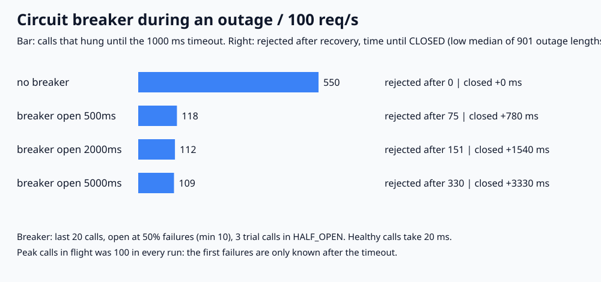

# API-03. Circuit breaker는 어떻게 동작하나요?

## 30초 답변

외부 서비스가 응답하지 않을 때 호출마다 타임아웃까지 기다리면 스레드와 커넥션이 묶입니다. circuit breaker는 최근 호출의 실패율이 기준을 넘으면 OPEN이 되어 호출을 바로 거절합니다. 정해진 시간이 지나면 HALF_OPEN에서 시험 호출 몇 개만 보내고, 성공하면 CLOSED로 돌아가고 실패하면 다시 OPEN이 됩니다. 장애 중 쌓이는 타임아웃을 줄이는 대신, 서비스가 살아난 뒤에도 잠시 막는 비용이 있어서 OPEN 시간과 타임아웃을 같이 정하겠습니다.

## 조금 더 깊게

- **CLOSED**: 평소 상태입니다. 호출을 보내고 결과를 window(최근 N개 또는 최근 N초)에 기록합니다. 최소 호출 수를 넘고 실패율이 기준 이상이면 OPEN으로 바꿉니다.
- **OPEN**: 외부 서비스를 호출하지 않고 바로 실패를 돌려줍니다. 이때 캐시 값이나 기본값 같은 fallback을 줄 수 있습니다.
- **HALF_OPEN**: OPEN 시간이 지나면 시험 호출을 정해진 수만 허용합니다. 결과에 따라 CLOSED나 OPEN으로 갑니다.
- **함께 정할 것**: 타임아웃, window 크기와 최소 호출 수, 실패율 기준, OPEN 시간, 시험 호출 수, 거절 시 응답입니다. 재시도를 함께 쓴다면 breaker가 OPEN일 때는 재시도하지 않아야 합니다([API-02](retry-backoff-jitter.md)).

## 직접 측정한 근거

2026-11-02, Python 3.13.12 / macOS(Darwin 25.6.0) / arm64에서 실행했습니다. 요청은 10ms마다 1개(초당 100개)이고, 외부 서비스는 정상이면 20ms에 성공, 장애 중에는 응답이 없어 타임아웃 1000ms 뒤 실패합니다. breaker는 최근 20개 중 실패 50% 이상(최소 10개)이면 OPEN, HALF_OPEN에서 시험 호출 3개가 모두 성공하면 CLOSED입니다. 장애는 1000ms에 시작하고 끝나는 시각을 2,000~11,000ms로 10ms씩 바꿔 901번 돌린 low median과 최소~최대입니다(지표마다 따로 구한 값). 정수 ms fake clock 시뮬레이션입니다.

| 정책 | 타임아웃까지 기다린 호출 | 복구 후 거절 | 복구 후 CLOSED까지 | 동시에 매달린 호출 최대 |
|---|---:|---:|---:|---:|
| breaker 없음 | 550 (100~1,000) | 0 | 0ms | 100 |
| OPEN 500ms | 118 (100~127) | 75 (1~148) | 780ms (40~1,530) | 100 |
| OPEN 2000ms | 112 (100~118) | 151 (1~298) | 1,540ms (40~3,030) | 100 |
| OPEN 5000ms | 109 (100~112) | 330 (1~598) | 3,330ms (40~6,030) | 100 |

장애 1000~6000ms 한 번만 보면, OPEN 2000ms는 2,090ms에 OPEN → 4,090ms HALF_OPEN → 5,090ms 시험 실패로 OPEN → 7,090ms HALF_OPEN → 7,130ms CLOSED 순서로 움직였습니다. breaker 없이 타임아웃 500번이던 것이 112번으로 줄었지만, 서비스가 6,000ms에 살아난 뒤 7,130ms까지 110개를 거절했습니다.

- 재현 코드와 전체 결과: [backend-lab/022-circuit-breaker](https://github.com/morningverse67-wq/backend-lab/tree/main/labs/022-circuit-breaker)
- 실행: `python3 main.py` (표준 라이브러리만 사용)
- 검증: `regression_checks=100 PASS`. 손으로 계산한 상태 전이와 호출 수, 10%·50% 간헐 실패에서 열리는지, 요청 수 보존, 같은 설정 재현성을 assert로 검사했습니다.
- 느린 응답 비율(slow call), 시간 기반 window, 여러 인스턴스, fallback 응답, 재시도와의 조합은 넣지 않았습니다.

## 꼬리 질문

**Q. breaker가 있으면 장애 초반의 피해도 막아 주나요?**  
아니요. 실패는 타임아웃이 지나야 알 수 있어서, 이 실험에서는 모든 정책에서 동시에 매달린 호출이 100개(초당 100개 × 1초)까지 갔습니다. 초반 피해를 줄이려면 타임아웃을 짧게 잡거나 느린 호출 비율도 실패로 세야 합니다.

**Q. OPEN 시간은 길게 잡는 게 안전하지 않나요?**  
장애 중 시험 호출은 줄지만(118 → 109번), 서비스가 살아난 뒤에도 오래 막습니다. 이 조건에서 복구 후 거절이 75개(500ms)에서 330개(5000ms)로 늘었습니다. 외부 서비스가 보통 얼마 만에 회복되는지와 거절의 비용을 보고 정하겠습니다.

**Q. 실패 몇 번이면 열리게 하나요?**  
횟수보다 window 안의 실패율과 최소 호출 수로 정합니다. 이 실험에서 10번 중 1번 실패(10%)는 한 번도 열리지 않았고, 2번 중 1번 실패(50%)는 열렸습니다. 요청이 적을 때 한두 번 실패로 열리지 않도록 최소 호출 수를 둡니다.

## 흔한 오답

- “breaker를 쓰면 타임아웃은 필요 없습니다.” → breaker는 실패를 보고 판단합니다. 타임아웃이 없으면 실패가 끝나지 않아 열리지도 않습니다.
- “OPEN이면 서비스가 죽은 것입니다.” → 이 실험에서는 서비스가 정상인데도 최대 598개까지 거절했습니다. OPEN은 마지막으로 본 상태일 뿐입니다.
- “breaker는 재시도의 한 종류입니다.” → 재시도는 다시 보내는 쪽이고, breaker는 보내지 않는 쪽입니다. 함께 쓸 때는 OPEN에서 재시도를 멈춰야 합니다.

## 참고

- [Martin Fowler: CircuitBreaker](https://martinfowler.com/bliki/CircuitBreaker.html)
- [Resilience4j: CircuitBreaker](https://resilience4j.readme.io/docs/circuitbreaker)
- [Microsoft Azure Architecture Center: Circuit Breaker pattern](https://learn.microsoft.com/en-us/azure/architecture/patterns/circuit-breaker)
