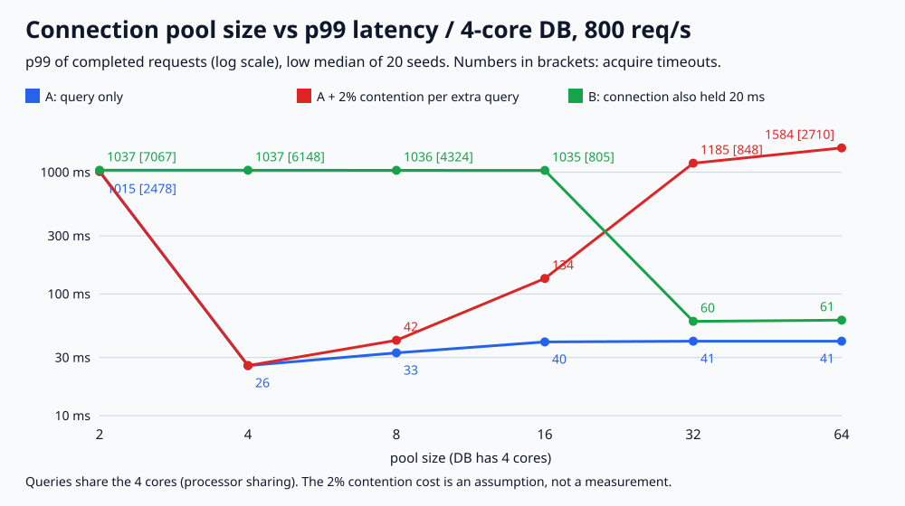

# API-04. 커넥션 풀 크기는 어떻게 정하나요?

## 30초 답변

커넥션 풀은 DB 처리 능력을 늘려 주지 않고, 요청이 어디서 기다릴지를 정합니다. 풀이 DB가 처리해야 할 양보다 작으면 커넥션 대기가 쌓여 타임아웃이 나고, 충분히 크면 그 위로는 대기가 풀에서 DB 안으로 옮겨 갈 뿐입니다. 그래서 필요한 커넥션 수를 초당 요청 수 × 커넥션 1회 점유 시간으로 먼저 잡고, DB 코어 수에 가까운 작은 값에서 시작해 풀 대기 시간과 DB 부하를 보며 조정하겠습니다. 점유 시간이 길다면 풀을 키우기 전에 트랜잭션 안의 외부 호출 같은 원인을 줄이겠습니다.

## 조금 더 깊게

- **너무 작을 때**: 동시에 쓸 수 있는 커넥션 수가 처리량 상한이 됩니다. 들어오는 양보다 적으면 대기가 계속 늘고 `connectionTimeout`에 걸려 실패합니다.
- **너무 클 때**: DB에 동시에 들어가는 쿼리가 늘어 코어, 락, 버퍼를 나눠 씁니다. 처리량은 그대로인데 개별 쿼리가 길어지고, 동시 실행 비용이 큰 DB라면 오히려 처리량이 떨어집니다.
- **점유 시간**: Little의 법칙으로 평균 사용 중 커넥션 = 초당 요청 수 × 1회 점유 시간입니다. 트랜잭션 안에서 외부 API를 부르거나 결과를 오래 붙잡으면 같은 쿼리여도 필요한 커넥션이 늘어납니다.
- **여러 인스턴스**: DB가 받는 커넥션은 인스턴스 수 × 풀 크기입니다. 인스턴스를 늘릴 때 풀 크기도 함께 봐야 합니다.
- **출발점**: HikariCP 문서는 코어 수 × 2 + 디스크 수를 출발점 공식으로 소개합니다. 이 값에서 시작해 풀 대기 시간, 사용 중 커넥션 수, DB CPU를 보며 맞추겠습니다.

## 직접 측정한 근거

2026-11-03, Python 3.13.12 / macOS(Darwin 25.6.0) / arm64에서 실행했습니다. 4코어 DB에 초당 800개 요청(포아송, 10초)이 오고, 쿼리 하나는 DB CPU를 평균 4ms 씁니다(사용률 80%). 실행 중인 쿼리는 코어를 나눠 쓰고, 커넥션을 1,000ms 안에 못 받으면 포기합니다. seed 1~20의 low median과 최소~최대이며(지표마다 따로 구한 값), 가상 시계 시뮬레이션입니다.

| 풀 | 쿼리만: p99 | 쿼리만: 포기 | 경합 2% 가정: p99 | 경합 2% 가정: 포기 | 20ms 더 쥠: p99 | 20ms 더 쥠: 포기 |
|---:|---:|---:|---:|---:|---:|---:|
| 2 | 1,014.87ms | 2,478 | 1,014.87ms | 2,478 | 1,036.80ms | 7,067 |
| 4 | 25.80ms | 0 | 25.80ms | 0 | 1,036.85ms | 6,148 |
| 8 | 32.78ms | 0 | 41.63ms | 0 | 1,036.29ms | 4,324 |
| 16 | 40.33ms | 0 | 133.81ms | 0 | 1,034.54ms | 805 |
| 32 | 40.86ms | 0 | 1,185.28ms | 848 | 59.51ms | 0 |
| 64 | 40.86ms | 0 | 1,583.54ms | 2,710 | 60.86ms | 0 |

쿼리만 할 때 풀 4개는 풀 대기 p99 19.61ms + DB 안 18.39ms였고, 풀 64개는 풀 대기 0ms + DB 안 40.86ms였습니다. p50은 5.46 → 4.08ms로 줄었지만 p99는 25.80 → 40.86ms로 늘었습니다. 커넥션을 20ms 더 쥐는 경우 1회 점유가 평균 26.92ms라 초당 800 × 26.92ms = 21.5개가 필요했고, 실제 평균 사용 중 커넥션도 21.54개였습니다. 그래서 16개에서 805개가 포기했고, 그동안 DB 동시 쿼리는 최대 10~13개로 한가했습니다.

- 재현 코드와 전체 결과: [backend-lab/023-connection-pool-size](https://github.com/morningverse67-wq/backend-lab/tree/main/labs/023-connection-pool-size)
- 실행: `python3 main.py` (표준 라이브러리만 사용)
- 검증: `regression_checks=39 PASS`. 손으로 계산한 대기·공유·경합·점유 시간, 풀 크기를 넘는 동시 쿼리가 없는지, 요청 수 보존, 같은 seed 재현성을 assert로 검사했습니다.
- 경합 2%는 실측이 아닌 가정입니다. 디스크·네트워크 I/O 대기, 여러 인스턴스, 커넥션 생성 비용은 넣지 않았습니다.

## 꼬리 질문

**Q. 커넥션 대기 타임아웃이 나면 풀을 늘리면 되지 않나요?**  
DB가 여유 있는데 커넥션을 오래 쥐는 경우라면 늘리는 게 맞을 수 있습니다. 하지만 DB가 이미 바쁘다면 대기가 DB 안으로 옮겨 갈 뿐입니다. 이 실험에서 경합 비용을 2%로 가정하면 풀 16개는 포기 0개였지만 32개는 848개가 포기했습니다. 먼저 사용 중 커넥션 수, 1회 점유 시간, DB CPU를 보고 원인을 나누겠습니다.

**Q. 풀이 크면 손해 볼 게 없지 않나요?**  
경합 비용이 없다고 둔 경우에도 p99가 25.80ms(4개)에서 40.86ms(64개)로 늘었습니다. 모든 쿼리가 한꺼번에 들어가 코어를 나눠 쓰면서 긴 쿼리가 더 길어지기 때문입니다. 대신 p50은 조금 줄었습니다(5.46 → 4.08ms).

**Q. 인스턴스를 4대로 늘리면 풀은 어떻게 하나요?**  
DB 입장에서는 커넥션이 인스턴스 수 × 풀 크기만큼 생깁니다. 전체 필요량을 먼저 정하고 인스턴스별로 나누겠습니다. 이 부분은 이 실험에서 측정하지 않았습니다.

## 흔한 오답

- “트래픽이 많으면 풀을 크게 잡습니다.” → 풀은 처리 능력이 아니라 대기 위치를 정합니다. DB가 감당하는 양보다 많이 열면 DB 안에서 기다립니다.
- “스레드 수만큼 커넥션을 잡습니다.” → 스레드가 커넥션을 쥐는 시간은 요청 전체 시간보다 짧을 수 있습니다. 필요한 수는 요청 수 × 점유 시간으로 봅니다.
- “`connectionTimeout`을 길게 하면 실패가 줄어듭니다.” → 처리량보다 많이 들어오면 대기만 길어지고 결국 실패합니다. 이 실험의 풀 2개는 처리 상한이 초당 약 500개라 1초를 기다려도 2,478개가 포기했습니다.

## 참고

- [HikariCP Wiki: About Pool Sizing](https://github.com/brettwooldridge/HikariCP/wiki/About-Pool-Sizing)
- [HikariCP README: Configuration (maximumPoolSize, connectionTimeout)](https://github.com/brettwooldridge/HikariCP)
- [PostgreSQL Wiki: Number Of Database Connections](https://wiki.postgresql.org/wiki/Number_Of_Database_Connections)
