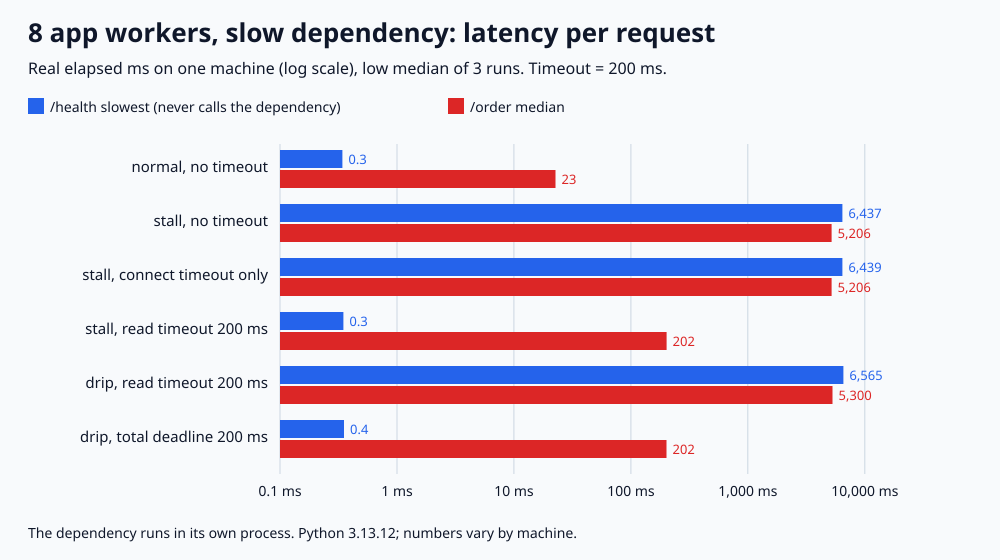

# API-06. 외부 API 호출에 타임아웃이 꼭 필요한 이유는?

## 30초 답변

외부 API가 응답하지 않으면 그 호출을 기다리는 워커도 같이 멈추기 때문입니다. 워커 수는 정해져 있어서, 느린 API 하나가 워커를 다 붙잡으면 그 API와 상관없는 요청까지 줄을 서게 됩니다. 그래서 연결 타임아웃과 읽기 타임아웃을 모두 걸고, 응답 전체가 일정 시간 안에 끝나야 하면 호출 전체 기한도 따로 두겠습니다. 타임아웃으로 실패를 빨리 돌려주면 서버의 나머지 기능은 살릴 수 있습니다.

## 조금 더 깊게

- **기본값은 무한 대기인 경우가 많습니다.** Python 소켓의 기본 타임아웃은 `None`이고, `requests`도 `timeout`을 주지 않으면 끝없이 기다립니다.
- **연결 타임아웃**: TCP 연결을 맺기까지의 한도입니다. 상대가 연결은 받아 놓고 응답만 늦추면 걸리지 않습니다.
- **읽기 타임아웃**: 데이터가 오지 않는 간격의 한도입니다. 바이트가 조금씩이라도 오면 다시 시작되므로 호출 전체 시간을 막아 주지 못합니다.
- **전체 기한(deadline)**: 호출 시작부터 끝까지의 한도입니다. 읽을 때마다 남은 시간으로 타임아웃을 다시 겁니다.
- **타임아웃은 내 쪽만 풀어 줍니다.** 상대 서버의 일은 계속되므로, 바로 재시도하면 상대에 요청이 더 쌓입니다. 재시도 간격(백오프)과 circuit breaker를 함께 봅니다.

## 직접 측정한 근거

2026-11-05, Python 3.13.12 / macOS(Darwin 25.6.0) / arm64에서 실행했습니다. 앱 서버는 워커 스레드 8개이고 `/order`는 외부 API를 부르며 `/health`는 부르지 않습니다. 2초 동안 `/order` 40건(초당 20건)과 `/health` 20건을 정해진 시각에 보냈습니다. 외부 API는 별도 프로세스이고, stall은 연결을 받은 뒤 2초 동안 응답하지 않고, drip은 100ms마다 1바이트씩 약 2초 동안 보냅니다. 조건마다 3번 돌린 low median이며 실제 시계로 잰 값입니다. 타임아웃은 200ms입니다.

| 외부 API | 앱의 호출 방식 | `/health` 최대 | `/order` 중앙값 | `/order` 결과 | 바쁜 워커 최대 |
|---|---|---:|---:|---|---:|
| 정상(20ms) | 타임아웃 없음 | 0.3ms | 22.7ms | 200 40건 | 2 |
| stall | 타임아웃 없음 | 6,437.2ms | 5,206.2ms | 200 40건 | 8 |
| stall | 연결 타임아웃만 | 6,439.1ms | 5,206.5ms | 200 40건 | 8 |
| stall | 읽기 타임아웃 200ms | 0.3ms | 202.1ms | 504 40건 | 5 |
| drip | 읽기 타임아웃 200ms | 6,564.7ms | 5,300.1ms | 200 40건 | 8 |
| drip | 전체 기한 200ms | 0.4ms | 201.6ms | 504 40건 | 5 |

타임아웃이 없으면 워커 8개가 2초씩 묶여, 외부 API를 부르지 않는 `/health`도 최대 6,437.2ms(중앙값 3,227.7ms)를 기다렸습니다. 연결 타임아웃만 건 경우는 상대가 연결을 바로 받아 줘서 결과가 같았습니다. 읽기 타임아웃 200ms를 걸면 주문은 504로 실패했지만 바쁜 워커가 최대 5개에 그쳐 `/health`는 0.3ms였습니다. 1바이트씩 흘리는 응답에는 읽기 타임아웃이 한 번도 걸리지 않았고, 전체 기한을 둬야 201.6ms에 끊겼습니다. 읽기 타임아웃 행에서 앱은 202ms에 손을 뗐지만 외부 API 쪽 동시 요청은 최대 40개까지 쌓였습니다(타임아웃 없음은 8개).

- 재현 코드와 전체 결과: [backend-lab/025-external-call-timeout](https://github.com/morningverse67-wq/backend-lab/tree/main/labs/025-external-call-timeout)
- 실행: `python3 main.py` (표준 라이브러리만 사용, 약 2분 10초)
- 검증: `regression_checks=28 PASS`. 호출 방식별로 stall·drip에서 끊기는지와 끊기는 시간(200ms 이상 500ms 미만), 워커 8개가 묶였을 때 `/health`가 1,800ms 이상 기다리는지, 잘못된 입력 거부를 assert로 검사했습니다.
- 로컬 루프백, 워커 8개, 초당 20건, 호출마다 2초 지연이라는 한 가지 조건입니다. 타임아웃 값은 200ms 하나만 쟀고, bulkhead, 비동기 서버, 실제 네트워크의 SYN 무응답, 커넥션 재사용은 재지 않았습니다.

## 꼬리 질문

**Q. 타임아웃 값은 어떻게 정하나요?**  
정상 응답 시간 분포(예: p99)보다 조금 길게 잡되, 그 요청을 처리하는 워커를 얼마나 오래 내줄 수 있는지로 위쪽을 정하겠습니다. 이 실험은 200ms 한 가지만 쟀습니다. 너무 짧으면 정상 응답도 끊고, 길수록 타임아웃 없음에 가까워집니다. 내 API에도 응답 기한이 있다면 외부 호출 기한은 그 안에 들어가야 합니다.

**Q. 연결 타임아웃만 걸면 안 되나요?**  
상대가 연결은 받아 주고 응답을 늦추는 경우를 막지 못합니다. 이 실험에서 연결 타임아웃만 건 경우는 타임아웃 없음과 같았습니다(`/health` 최대 6,439.1ms vs 6,437.2ms).

**Q. 읽기 타임아웃을 200ms로 걸면 호출이 200ms 안에 끝나나요?**  
아닙니다. 읽기 타임아웃은 바이트 사이의 대기 한도라서, 100ms마다 1바이트씩 오는 응답은 약 2초 동안 끊기지 않았습니다. 호출 전체를 제한하려면 시작 시각 기준의 기한을 두고 읽을 때마다 남은 시간을 다시 걸어야 합니다.

**Q. 타임아웃이 나면 바로 재시도하면 되나요?**  
타임아웃은 내 워커만 풀어 줄 뿐 상대 서버의 일은 계속됩니다. 이 실험에서도 앱은 202ms에 포기했지만 상대에는 동시 요청이 40개까지 쌓였습니다. 멱등한 요청만, 백오프와 jitter를 두고 재시도하고, 실패가 이어지면 circuit breaker로 호출 자체를 줄이겠습니다.

## 흔한 오답

- “라이브러리가 알아서 타임아웃을 걸어 줍니다.” → Python 소켓과 `requests`는 기본값이 무한 대기입니다. 직접 지정해야 합니다.
- “연결 타임아웃을 걸었으니 안전합니다.” → 연결된 뒤 응답이 오지 않는 경우는 읽기 타임아웃이 있어야 끊깁니다.
- “느린 API를 쓰는 기능만 느려집니다.” → 워커를 공유하면 상관없는 요청도 같은 줄에서 기다립니다. 이 실험에서 `/health`가 최대 6,437.2ms를 기다렸습니다.

## 참고

- [Python 문서: socket, 소켓 타임아웃에 관한 참고 사항](https://docs.python.org/3/library/socket.html#socket-timeouts)
- [Requests 문서: Timeouts](https://requests.readthedocs.io/en/latest/user/advanced/#timeouts)
- [Amazon Builders' Library: Timeouts, retries, and backoff with jitter](https://aws.amazon.com/builders-library/timeouts-retries-and-backoff-with-jitter/)
