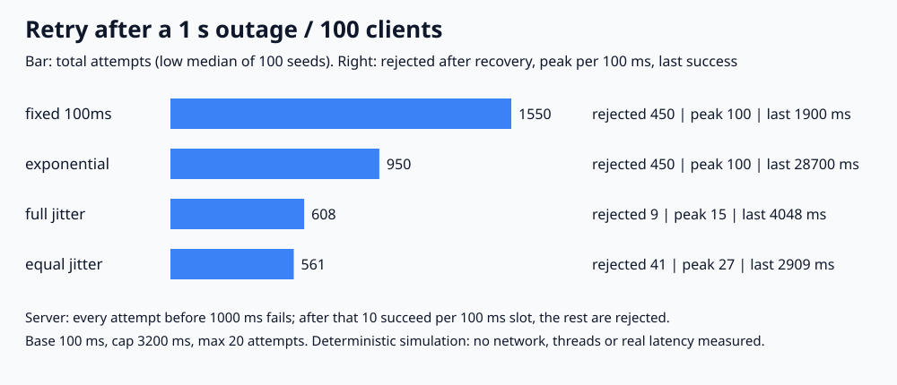

# API-02. 재시도할 때 지수 백오프와 jitter를 쓰는 이유는?

## 30초 답변

실패한 요청을 바로, 같은 간격으로 다시 보내면 장애 중인 서버에 부하를 더 얹습니다. 지수 백오프는 재시도할수록 대기 시간을 늘려 전체 시도 수를 줄입니다. 하지만 많은 클라이언트가 같은 순간에 실패했다면 대기 시간도 같아서 다시 같은 순간에 몰립니다. 그래서 대기 시간에 무작위 값(jitter)을 섞어 재시도 시각을 흩습니다. 대기 시간에는 상한(cap)과 최대 시도 수를 두고, 멱등한 요청만 재시도하겠습니다.

## 조금 더 깊게

- **지수 백오프**: n번째 재시도 대기를 `min(cap, base × 2^n)`으로 늘립니다. 시도 수는 줄지만, 동시에 실패한 클라이언트들의 재시도 시각은 여전히 같습니다.
- **Full jitter**: `0 ~ min(cap, base × 2^n)`에서 무작위로 고릅니다. 가장 넓게 흩지만 대기가 0에 가까울 수도 있습니다.
- **Equal jitter**: 위 값의 절반을 기본으로 기다리고 나머지 절반 안에서 무작위로 더합니다. 최소 대기는 보장하지만 흩어지는 폭이 절반입니다.
- **함께 정할 것**: cap, 최대 시도 수나 전체 기한, 재시도 가능한 오류의 범위, 멱등성입니다. 같은 결제 요청을 두 번 보내도 안전하지 않다면 재시도 전에 [멱등성 키](../transaction/idempotency-key.md)가 필요합니다.

## 직접 측정한 근거

2026-11-01, Python 3.13.12 / macOS(Darwin 25.6.0) / arm64에서 실행했습니다. 클라이언트 100개가 0ms에 동시에 요청하고, 서버는 1000ms까지 모두 실패시킨 뒤 100ms마다 10개만 성공시킵니다. base 100ms, cap 3200ms, 최대 20번 시도입니다. 정수 ms fake clock 시뮬레이션이며, jitter 정책은 seed 100개의 low median과 최소~최대입니다(지표마다 따로 구한 값).

| 정책 | 전체 시도 | 복구 후 거절 | 복구 후 100ms당 최대 시도 | 마지막 성공 |
|---|---:|---:|---:|---:|
| fixed 100ms | 1,550 | 450 | 100 | 1,900ms |
| exponential | 950 | 450 | 100 | 28,700ms |
| full jitter | 608 (593~627) | 9 (0~21) | 15 (10~24) | 4,048ms (3,616~4,673) |
| equal jitter | 561 (557~568) | 41 (31~52) | 27 (22~35) | 2,909ms (2,708~5,723) |

지수 백오프만 쓴 100개는 0, 100, 300, 700, 1500ms에 함께 보냈고, 1500ms에 10개만 성공한 뒤 나머지 90개가 다시 3100ms에 같이 몰렸습니다. 처리 용량이 100ms당 10개인데 복구 직후 구간마다 100번이 몰린 셈입니다. Full jitter는 같은 백오프에서 복구 후 거절을 450번에서 9번으로 줄였습니다.

- 재현 코드와 전체 결과: [backend-lab/021-retry-backoff-jitter](https://github.com/morningverse67-wq/backend-lab/tree/main/labs/021-retry-backoff-jitter)
- 실행: `python3 main.py` (표준 라이브러리만 사용)
- 검증: `regression_checks=55 PASS`. 대기 값과 cap, jitter 범위, fixed·exponential의 손 계산 결과, 용량 초과 성공이 없는지, 같은 seed 재현성을 assert로 검사했습니다.
- 서버가 과부하에서 느려지거나 다시 죽는 효과, 네트워크·타임아웃·실제 latency는 넣지 않았습니다.

## 꼬리 질문

**Q. 이 실험에서는 고정 100ms 재시도가 제일 빨리 끝났는데요?**  
네, 1,900ms로 가장 빨랐습니다. 이 모델의 서버는 몰려도 매 100ms 10개씩 꾸준히 처리하기 때문입니다. 대신 시도가 1,550번이었고 복구 직후 용량의 10배가 몰렸습니다. 실제 서버는 과부하에서 느려지거나 다시 장애가 날 수 있는데, 이 실험은 그 효과를 넣지 않았으므로 고정 재시도가 빠르다고 결론 내리지 않겠습니다.

**Q. Full jitter와 equal jitter 중 무엇을 쓰나요?**  
이번 조건에서는 full jitter가 복구 후 몰림이 적었고(거절 9 vs 41번), equal jitter는 전체 시도가 조금 적었습니다(561 vs 608번). 실험 하나로 정답을 정하기보다 서버가 감당할 몰림과 최소 대기 필요 여부로 고르겠습니다.

**Q. 서버가 `Retry-After`를 주면요?**  
서버가 다시 시도할 시점을 알려주면 그 값을 우선 고려합니다. 다만 모든 클라이언트가 같은 값을 받으면 다시 같은 시각에 몰릴 수 있습니다. 이 실험에는 `Retry-After` 처리를 구현하지 않았습니다.

## 흔한 오답

- “지수 백오프를 쓰면 몰림이 해결됩니다.” → 간격만 늘어나고 동시에 실패한 요청은 계속 같이 움직였습니다(복구 후 거절 450번).
- “재시도는 많이 할수록 성공률이 올라갑니다.” → 장애 중의 재시도는 부하만 늘립니다. cap, 최대 시도 수, 기한이 필요합니다.
- “모든 실패를 재시도합니다.” → 4xx 같은 요청 오류나 멱등하지 않은 요청은 재시도하면 안 되거나 멱등성 키가 먼저 필요합니다.

## 참고

- [AWS Architecture Blog: Exponential Backoff And Jitter](https://aws.amazon.com/blogs/architecture/exponential-backoff-and-jitter/)
- [Google Cloud Storage: Retry strategy](https://cloud.google.com/storage/docs/retry-strategy)
- [RFC 9110 §10.2.3: Retry-After](https://www.rfc-editor.org/rfc/rfc9110.html#section-10.2.3)
