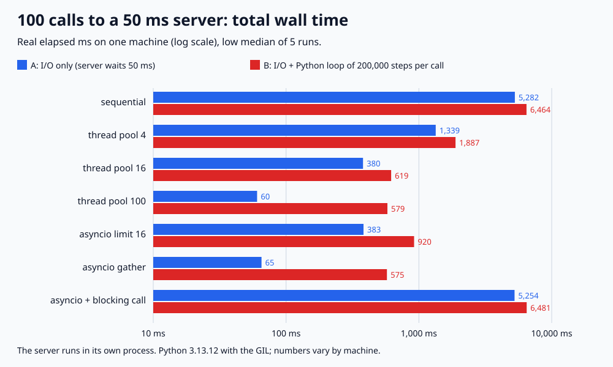

# API-05. I/O 작업은 동기, 스레드 풀, asyncio 중 무엇으로 처리하나요?

## 30초 답변

외부 API나 DB 응답을 기다리는 시간이 대부분이라면 스레드 풀이나 asyncio로 기다림을 겹쳐야 합니다. 둘 다 빨라지는 이유는 같고, 속도는 동시에 몇 개를 기다리느냐로 정해집니다. 그래서 먼저 상대 서버가 감당할 동시 수를 정하고, 기존 코드가 블로킹 라이브러리 위에 있으면 스레드 풀, 호출 경로를 모두 논블로킹으로 만들 수 있고 동시 연결이 많으면 asyncio를 고르겠습니다. 다만 CPU를 쓰는 부분은 Python에서 GIL 때문에 둘 다 나눠 주지 못하므로 따로 떼어 보겠습니다.

## 조금 더 깊게

- **순차**: 호출 하나가 끝나야 다음을 보냅니다. 전체 시간은 대략 호출 수 × 응답 시간입니다.
- **스레드 풀**: 스레드마다 블로킹 호출 하나를 기다립니다. 소켓을 기다리는 동안 GIL이 풀리므로 기다림은 겹칩니다. 동시 수는 풀 크기입니다.
- **asyncio**: 스레드 하나의 이벤트 루프가 여러 코루틴을 번갈아 돌립니다. 기다리는 지점마다 `await`로 루프에 제어를 돌려줘야 하므로, 중간에 블로킹 호출이 하나라도 있으면 루프 전체가 멈춥니다.
- **동시 수 제한**: 스레드 풀 크기나 `asyncio.Semaphore`는 상대 서버와 커넥션 풀을 보호하는 장치이기도 합니다. 무제한 `gather`는 요청을 한꺼번에 보냅니다.
- **CPU 작업**: GIL이 있는 Python에서는 스레드를 늘려도 Python 코드는 한 번에 하나만 돕니다. asyncio에서는 계산하는 동안 다른 요청을 보내지도 받지도 못합니다.

## 직접 측정한 근거

2026-11-04, Python 3.13.12(GIL 켜짐) / macOS(Darwin 25.6.0) / arm64에서 실행했습니다. 별도 프로세스의 로컬 서버가 요청마다 50ms 기다렸다 답하고, 클라이언트가 100번 호출합니다. 방식마다 5번 돌린 low median이며 실제 시계로 잰 값입니다. "+ CPU"는 응답마다 Python 반복문 20만 번을 더 돈 경우입니다.

| 방식 | 동시 수(서버 관측) | 응답만 | 응답 + CPU | 응답 + CPU일 때 클라이언트 CPU |
|---|---:|---:|---:|---:|
| 순차 | 1 | 5,281.5ms | 6,464.4ms | 1,205.3ms |
| 스레드 풀 16 | 16 | 379.7ms | 618.6ms | 533.2ms |
| asyncio 동시 16 | 16 | 383.1ms | 920.0ms | 553.9ms |
| 스레드 풀 100 | 100 | 60.5ms | 579.2ms | 592.5ms |
| asyncio gather | 100 | 65.3ms | 574.8ms | 522.4ms |
| asyncio + 블로킹 호출 | 1 | 5,254.4ms | 6,480.6ms | 1,244.2ms |

응답만 받을 때는 같은 동시 수끼리 시간이 비슷했습니다(16: 379.7 vs 383.1ms, 100: 60.5 vs 65.3ms). 100개를 동시에 기다리는 데 쓴 클라이언트 CPU는 asyncio 13.4ms, 스레드 22.7ms였습니다. `async def` 안에서 블로킹 호출을 쓰면 서버가 본 동시 요청이 1개라 순차와 같았습니다. CPU 반복문을 붙이면 스레드 100개도 579.2ms로 클라이언트 CPU 합(592.5ms)만큼 걸렸고, 동시 16에서는 계산 중 다음 요청을 못 보내는 asyncio(920.0ms)가 스레드(618.6ms)보다 느렸습니다.

- 재현 코드와 전체 결과: [backend-lab/024-sync-threadpool-asyncio](https://github.com/morningverse67-wq/backend-lab/tree/main/labs/024-sync-threadpool-asyncio)
- 실행: `python3 main.py` (표준 라이브러리만 사용, 약 2분 30초)
- 검증: `regression_checks=26 PASS`. 호출 1번의 최소 시간, 동시 수별 하한(`ceil(n ÷ 동시 수) × 50ms`), 서버가 본 동시 요청 ≤ 제한, 순서가 섞여 끝나도 응답이 자기 요청과 맞는지, 잘못된 입력 거부를 assert로 검사했습니다.
- 로컬 루프백, 고정 50ms 지연, 호출마다 새 연결입니다. 실제 네트워크 변동, keep-alive, 수천 개 동시 연결의 메모리, 프로세스 풀, free-threaded 빌드는 재지 않았습니다.

## 꼬리 질문

**Q. asyncio가 스레드보다 빠른 것 아닌가요?**  
기다리는 일만 놓고 보면 같은 동시 수에서 비슷했습니다(100개: 스레드 60.5ms, gather 65.3ms). 차이는 동시 연결 하나에 드는 비용에서 납니다. 이 실험에서 100개를 기다리는 데 쓴 CPU는 asyncio 13.4ms, 스레드 22.7ms였고, 연결 수가 수천 개로 늘면 스레드마다 드는 메모리도 커집니다. 메모리는 이 실험에서 재지 않았습니다.

**Q. asyncio 코드에서 꼭 써야 하는 블로킹 라이브러리가 있으면요?**  
`asyncio.to_thread`나 `loop.run_in_executor`로 스레드에 넘기겠습니다. 그대로 부르면 이 실험처럼 이벤트 루프가 멈춰 순차와 같아집니다(5,254.4ms vs 5,281.5ms).

**Q. CPU 작업이 섞여 있으면요?**  
GIL이 있는 Python에서는 스레드 100개도 클라이언트 CPU 합(592.5ms)만큼 걸렸습니다. 계산이 크면 프로세스 풀이나 별도 작업자로 나누고, I/O 부분만 스레드나 asyncio로 처리하겠습니다. asyncio에서는 계산 중에 다른 요청이 멈추므로 계산을 executor로 넘기는 것도 방법입니다.

## 흔한 오답

- “asyncio로 바꾸면 무조건 빨라집니다.” → 빨라지는 이유는 기다림을 겹치기 때문이고, 스레드 풀도 같은 동시 수면 비슷했습니다. 호출 경로에 블로킹 코드가 남아 있으면 순차와 같습니다.
- “스레드를 늘리면 CPU 작업도 빨라집니다.” → GIL이 있는 Python에서는 Python 코드가 한 번에 한 스레드만 돌아서, CPU 작업은 스레드 수와 상관없이 합만큼 걸렸습니다.
- “동시 수는 많을수록 좋습니다.” → 상대 서버, 커넥션 풀, 파일 디스크립터에도 한도가 있습니다. 필요한 만큼으로 제한하겠습니다.

## 참고

- [Python 문서: asyncio로 개발하기 (블로킹 코드 실행, 동시성과 멀티스레딩)](https://docs.python.org/3/library/asyncio-dev.html)
- [Python 문서: concurrent.futures.ThreadPoolExecutor](https://docs.python.org/3/library/concurrent.futures.html#threadpoolexecutor)
- [Python 문서: asyncio.to_thread](https://docs.python.org/3/library/asyncio-task.html#asyncio.to_thread)
