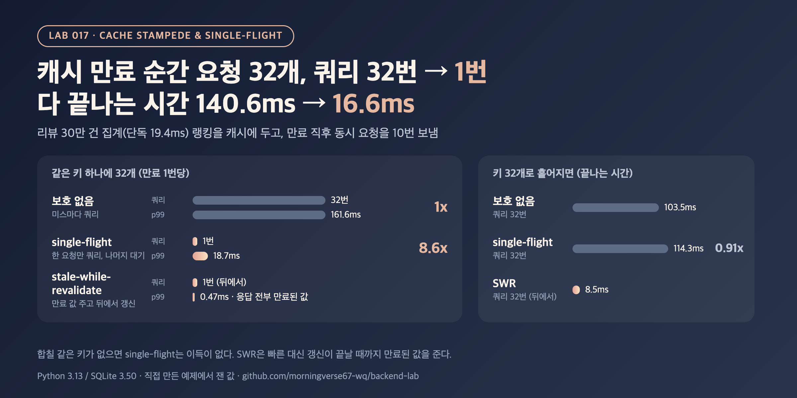

# CA-02. Cache stampede란 무엇이고 어떻게 막나요?

## 30초 답변

인기 있는 캐시 키가 만료되는 순간 요청이 몰리면, 그 요청들이 모두 미스를 보고 같은 쿼리를 동시에 DB로 보내는 현상입니다. 캐시가 막아 주던 부하가 한꺼번에 DB로 가서 쿼리가 서로 느려집니다. 같은 키의 미스는 한 요청만 DB를 읽고 나머지는 그 결과를 기다리게 하는 single-flight(요청 합치기)로 막거나, 만료된 값을 잠깐 더 주면서 뒤에서 한 번만 갱신하는 stale-while-revalidate로 막습니다. 아래 실험에서 같은 키로 32개가 몰리자 쿼리가 32번 돌아 140.6ms가 걸렸고, single-flight로는 쿼리 1번에 16.6ms였습니다.

## 조금 더 깊게

```python
# single-flight: 키마다 처음 미스를 본 요청 하나만 DB를 읽고, 나머지는 기다렸다가 같은 결과를 받는다
def get(key):
    entry = cache.get(key)
    if entry and not entry.expired:
        return entry.value
    with lock:
        call = in_flight.get(key)
        leader = call is None
        if leader:
            call = in_flight[key] = Call()        # threading.Event + value
    if not leader:
        call.event.wait()
        return call.value
    try:
        call.value = load_from_db(key)            # 이 키의 쿼리는 여기서 한 번만
        cache.set(key, call.value)
    finally:
        with lock:
            del in_flight[key]
        call.event.set()
    return call.value
```

- **single-flight는 같은 키만 합칩니다**: Go의 `golang.org/x/sync/singleflight` 패키지도 "같은 키에 대해 실행 중인 작업은 하나만" 두는 중복 억제 장치로 설명합니다. 키가 서로 다르면 합칠 것이 없습니다.
- **stale-while-revalidate는 기다림을 없애는 대신 만료된 값을 줍니다**: HTTP 캐시 확장(RFC 5861)으로 정의된 방식으로, 만료된 응답을 정해진 시간 동안 내주면서 막지 않고(non-blocking) 다시 확인합니다.
- **서버 한 대 안의 락은 그 서버 안에서만 합칩니다**: 서버가 10대면 같은 키라도 쿼리는 최대 10번입니다. 그것까지 줄이려면 외부 캐시에 갱신 중 표시를 두는 분산 락 같은 장치가 필요합니다.
- **만료 시각을 흩는 것도 같은 문제의 다른 축입니다**: 많은 키가 같은 시각에 만료되지 않게 TTL에 무작위 값을 더하는 방법(CA-03)은 여러 키의 동시 만료를, single-flight는 한 키의 동시 미스를 다룹니다.

## 직접 측정한 근거



SQLite 파일 DB(WAL)에 리뷰 30만 건을 두고, 카테고리별 평점 랭킹(인덱스 없이 30만 건 집계, 단독 19.4ms)을 캐시했습니다. 캐시 항목을 강제로 만료시킨 뒤 동시 요청을 한꺼번에 보내는 것을 10번 반복했고, 3회 실행의 지표별 중앙값입니다. 쿼리 수는 만료 10번의 합계입니다.

| 키 | 동시 요청 | 방식 | DB 쿼리 | 만료된 값 응답 | 요청 1건 p99 | 끝나는 시간 |
|---|---:|---|---:|---:|---:|---:|
| 같은 키 1개 | 8 | 보호 없음 | 80 | 0 | 69.72ms | 39.1ms |
| 같은 키 1개 | 8 | single-flight | 10 | 0 | 27.20ms | 19.7ms |
| 같은 키 1개 | 32 | 보호 없음 | 320 | 0 | 161.63ms | 140.6ms |
| 같은 키 1개 | 32 | single-flight | 10 | 0 | 18.73ms | 16.6ms |
| 같은 키 1개 | 32 | SWR | 10 | 320 | 0.47ms | 0.7ms |
| 키 32개로 흩어짐 | 32 | 보호 없음 | 320 | 0 | 119.54ms | 103.5ms |
| 키 32개로 흩어짐 | 32 | single-flight | 320 | 0 | 138.78ms | 114.3ms |
| 키 32개로 흩어짐 | 32 | SWR | 320 | 320 | 3.58ms | 8.5ms |

- 같은 키에 32개가 몰리면 쿼리 32개가 CPU를 나눠 써서, 단독 19.4ms인 쿼리가 p99 161.63ms까지 느려졌습니다. single-flight는 쿼리를 1번으로 줄여 끝나는 시간이 8.5배 빨라졌고, 기다린 요청도 쿼리 1번 시간(p99 18.73ms)만큼만 기다렸습니다.
- 요청이 키 32개로 흩어지면 single-flight는 합칠 것이 없어 쿼리가 그대로 320번이었고 0.91배(103.5ms → 114.3ms)로 이득이 없었습니다. SWR은 가장 빨랐지만 만료 순간의 응답은 모두 만료된 값이었습니다.
- 재현 코드: [backend-lab/017-cache-stampede-single-flight](https://github.com/morningverse67-wq/backend-lab/tree/main/labs/017-cache-stampede-single-flight)

<sub>Python 3.13 / SQLite 3.50, 파일 DB(WAL), CPU 10개. 한 프로세스 안의 스레드와 메모리 캐시로 잰 값이고, 서버 여러 대나 Redis 같은 외부 캐시는 재지 않았습니다. SWR의 끝나는 시간에는 백그라운드 갱신 시간이 들어 있지 않고, 실험 중 데이터를 바꾸지 않아 만료된 값도 내용은 같았습니다. 보호 없음의 쿼리 수는 늦게 출발한 요청이 먼저 끝난 쿼리가 채운 캐시를 읽으면 동시 요청 수보다 적을 수 있습니다(다시 돌렸을 때 320번 중 317번). 환경에 따라 수치는 달라질 수 있음.</sub>

## 꼬리 질문

**Q. single-flight로 기다리던 요청은 결국 느려지지 않나요?**  
기다리긴 하지만 쿼리 1번 시간만큼입니다. 실험에서 같은 키 32개일 때 p99는 보호 없음 161.63ms, single-flight 18.73ms였습니다. 각자 쿼리하면 32개가 DB와 CPU를 나눠 써서 모두 느려지기 때문에, 하나를 기다리는 편이 오히려 빨랐습니다. 다만 먼저 간 요청의 쿼리가 실패하거나 아주 오래 걸리면 기다리는 요청도 같이 실패하거나 늦어지므로, 대기에 타임아웃을 두고 실패는 다음 요청이 다시 시도하게 합니다.

**Q. single-flight와 stale-while-revalidate는 언제 각각 쓰나요?**  
조금 늦은 값을 줘도 되는지로 고릅니다. 랭킹, 인기 글 목록처럼 몇 초 늦어도 되는 데이터는 SWR이 응답을 막지 않아 좋습니다(실험에서 p99 0.47ms). 대신 그 순간의 응답 320건이 모두 만료된 값이었습니다. 재고나 가격처럼 바로 맞아야 하거나, 처음이라 돌려줄 옛 값이 없을 때는 single-flight로 한 번만 읽고 기다리게 합니다.

**Q. 서버가 여러 대면 어떻게 하나요?**  
서버 안의 single-flight는 서버마다 쿼리를 1번으로 줄여 줍니다. 서버 수만큼의 쿼리도 부담이면 Redis 같은 공유 캐시에 갱신 중 표시를 짧은 만료 시간과 함께 두고 한 서버만 갱신하게 하거나, 만료 전에 미리 갱신합니다. 이 부분은 직접 재지 않았습니다.

## 흔한 오답

- "TTL을 길게 잡으면 stampede가 없어집니다" → 만료 횟수만 줄 뿐, 만료되는 순간 요청이 몰리면 똑같이 생깁니다. 실험의 만료 1번마다 쿼리 32번이 그 모습입니다. 그리고 TTL이 길수록 바뀐 값이 늦게 반영됩니다.
- "single-flight를 모든 캐시 조회에 걸면 항상 빨라집니다" → 같은 키가 겹칠 때만 효과가 있습니다. 키가 흩어진 요청에서는 쿼리 수가 그대로였고 0.91배로 조금 느렸습니다.

## 참고

- [Go: golang.org/x/sync/singleflight](https://pkg.go.dev/golang.org/x/sync/singleflight)
- [RFC 5861: HTTP Cache-Control Extensions for Stale Content (stale-while-revalidate)](https://www.rfc-editor.org/rfc/rfc5861)
- [MDN: Cache-Control (stale-while-revalidate)](https://developer.mozilla.org/en-US/docs/Web/HTTP/Reference/Headers/Cache-Control)
