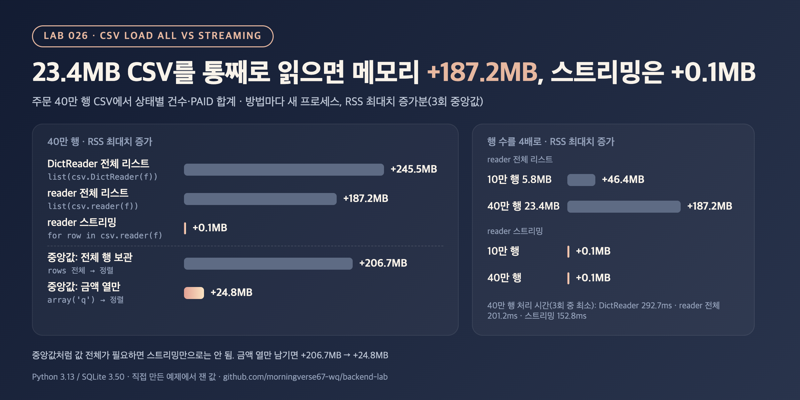

# DP-01. 대용량 CSV 파일을 메모리 걱정 없이 처리하려면 어떻게 하나요?

## 30초 답변

파일 전체를 리스트로 읽지 않고, 한 행씩 읽으면서 필요한 값만 누적하는 스트리밍 방식으로 처리하겠습니다. 한 번에 읽으면 메모리는 파일 크기가 아니라 행마다 만들어지는 객체 크기만큼 들어서, 직접 재 보니 23.4MB CSV가 리스트로는 메모리 최대치를 187.2MB 늘렸고 스트리밍은 0.1MB였습니다. 다만 중앙값이나 정렬처럼 값 전체가 필요한 작업은 스트리밍만으로 끝나지 않아서, 필요한 열만 남기거나 DB에 넣고 SQL로 처리하겠습니다.

## 조금 더 깊게

```python
rows = list(csv.reader(f))          # 모든 행이 리스트로 메모리에 남음
for row in rows: ...

for row in csv.reader(f):           # reader는 이터레이터: 지금 행 하나만 메모리에
    count[row[2]] += 1
```

- `csv.reader`는 파일을 한 줄씩 읽어 행을 하나씩 돌려주는 이터레이터입니다. `list()`로 감싸는 순간 모든 행이 한꺼번에 메모리에 올라갑니다.
- 행 하나는 리스트 객체 하나와 문자열 객체 여러 개입니다. Python 객체마다 머리 부분이 붙어서, 메모리는 파일 바이트 수보다 몇 배 커집니다. `DictReader`는 행마다 dict까지 만들어 더 큽니다.
- 건수·합계·최댓값처럼 한 행씩 누적할 수 있는 집계는 스트리밍으로 메모리가 행 수와 상관없이 일정합니다.
- 중앙값·정렬·여러 번 훑기처럼 전체 값이 필요한 작업은 필요한 열만 압축해서 남기거나(`array`), 여러 번 나눠 읽거나, DB에 적재한 뒤 SQL로 처리합니다.

## 직접 측정한 근거



주문 CSV(6개 열) 40만 행, 23.4MB에서 상태별 건수와 PAID 금액 합계, 금액 중앙값을 구했습니다. 방법마다 새 프로세스에서 돌려 작업 전후 `ru_maxrss` 차이(RSS 최대치 증가, 3회 중앙값)를 쟀고, Python 할당량은 tracemalloc으로 따로 1회 쟀습니다. 파일은 미리 OS 캐시에 올려 두었습니다.

| 방법 | 시간 (ms) | RSS 최대치 증가 (MB) | tracemalloc 최대치 (MB) | 파일 크기 대비 |
|---|---:|---:|---:|---:|
| `list(csv.DictReader(f))` 뒤 집계 | 292.7 | 245.5 | 231.13 | 9.87배 |
| `list(csv.reader(f))` 뒤 집계 | 201.2 | 187.2 | 170.33 | 7.27배 |
| `for row in csv.reader(f)` 스트리밍 | 152.8 | 0.1 | 0.05 | 0.00배 |
| 중앙값: 전체 행 보관 후 정렬 | 222.4 | 206.7 | 188.01 | 8.03배 |
| 중앙값: 금액 열만 `array('q')`에 보관 후 정렬 | 170.2 | 24.8 | 22.51 | 0.96배 |

| 행 수 (파일) | 한 번에 읽기 (reader 리스트) | 스트리밍 |
|---|---:|---:|
| 10만 행 (5.8MB) | +46.4MB | +0.1MB |
| 40만 행 (23.4MB) | +187.2MB | +0.1MB |

- 한 번에 읽는 방식은 행 수에 비례해 늘었고, 스트리밍은 두 크기 모두 0.1MB였습니다. 큰 리스트를 만들지 않으니 시간도 201.2ms → 152.8ms로 줄었습니다.
- 다섯 방법 모두 같은 건수·합계·중앙값을 냈고(중앙값은 SQLite로 한 번 더 확인), 시간은 3회 중 최소값입니다.
- 재현 코드: [backend-lab/026-csv-load-vs-streaming](https://github.com/morningverse67-wq/backend-lab/tree/main/labs/026-csv-load-vs-streaming)

<sub>Python 3.13.12 / SQLite 3.50.4, macOS arm64. 시간은 3회 중 최소값, RSS는 3회 중앙값. 환경에 따라 수치는 달라질 수 있음.</sub>

## 꼬리 질문

**Q. 그럼 항상 스트리밍으로 읽어야 하나요?**  
아닙니다. 10만 행(5.8MB)은 한 번에 읽어도 46.4MB였습니다. 서버 메모리에 비해 작고 한 번만 처리하는 파일이라면 단순한 코드가 낫습니다. 파일 크기에 상한이 없거나 동시에 여러 요청이 처리될 때 스트리밍이 필요합니다.

**Q. 중앙값처럼 전체 데이터가 필요하면요?**  
필요한 열만 남기는 것이 먼저입니다. 이 실험에서 전체 행을 들고 정렬하면 206.7MB, 금액만 `array('q')`에 모으면 24.8MB였습니다. 그보다 커지면 DB에 적재해서 `ORDER BY`나 집계 함수로 처리하겠습니다.

**Q. 업로드된 CSV를 DB에 넣을 때는요?**  
한 행씩 읽으면서 일정 개수(예: 1,000건)씩 묶어 `executemany`로 넣고 커밋하겠습니다. 행마다 커밋하면 느리고([DB-07](../database/bulk-insert.md)), 전체를 한 트랜잭션으로 묶으면 1건 실패에 전부 되돌아갑니다.

## 흔한 오답

- "파일이 23MB니까 메모리도 23MB 정도 씁니다" → 행마다 Python 객체가 생겨 7~10배였습니다(187.2MB, DictReader 245.5MB).
- "스트리밍은 메모리를 아끼는 대신 느립니다" → 이 실험에서는 큰 리스트를 만들지 않아 오히려 빨랐습니다(201.2ms → 152.8ms). 다만 스트리밍 루프 안에서 행을 다시 리스트에 쌓으면 이득이 사라집니다.

## 참고

- [Python 문서: csv.reader](https://docs.python.org/3/library/csv.html#csv.reader)
- [Python 문서: csv.DictReader](https://docs.python.org/3/library/csv.html#csv.DictReader)
- [Python 문서: resource.getrusage (ru_maxrss)](https://docs.python.org/3/library/resource.html#resource.getrusage)
- [Python 문서: tracemalloc.get_traced_memory](https://docs.python.org/3/library/tracemalloc.html#tracemalloc.get_traced_memory)
- [pandas 문서: read_csv (chunksize)](https://pandas.pydata.org/docs/reference/api/pandas.read_csv.html)
