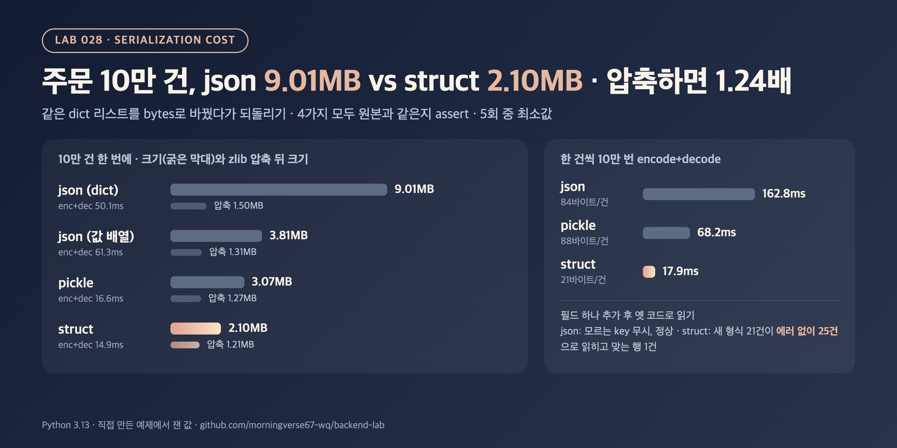

# DP-03. JSON, pickle, 바이너리 같은 직렬화 형식은 어떻게 고르나요?

## 30초 답변

기본은 JSON으로 하고, 크기나 직렬화 시간이 실제 병목으로 확인될 때만 바이너리 형식을 고려하겠습니다. 직접 재 보니 주문 10만 건이 JSON 9.01MB, 고정 길이 바이너리(struct) 2.10MB로 4.29배 차이였지만, zlib으로 압축하면 1.50MB vs 1.21MB로 1.24배까지 줄었습니다. 바이너리는 필드 순서와 크기를 양쪽이 똑같이 알아야 해서, 필드를 하나 추가하자 옛 코드가 데이터를 에러 없이 잘못 읽었습니다. pickle은 Python 전용이고 믿을 수 없는 입력에 쓰면 안 되니 서비스 간 통신에는 쓰지 않겠습니다.

## 조금 더 깊게

```python
json.dumps(rows, separators=(",", ":")).encode()   # 9.01MB, 행마다 key 이름 반복
pickle.dumps(rows, protocol=5)                     # 3.07MB, Python에서만 읽힘

ROW = struct.Struct("<IIBIq")                      # u32, u32, u8, u32, i64 = 21바이트
ROW.pack(order_id, user_id, status_code, amount, created_at)
```

- JSON 크기의 절반 이상은 행마다 반복되는 key 이름입니다. 대신 사람이 읽을 수 있고, 어느 언어에서나 읽히고, 모르는 key는 무시하면 되니 필드 추가에 강합니다.
- 고정 길이 바이너리는 key도 구분자도 없어 가장 작고 빠르지만, 스키마가 코드에만 있습니다. 필드가 바뀌면 보내는 쪽과 받는 쪽을 함께 바꿔야 하고, 버전 필드나 길이 정보가 없으면 잘못 읽어도 모를 수 있습니다.
- 실무에서 바이너리가 필요하면 struct를 직접 쓰기보다 Protocol Buffers처럼 스키마와 필드 번호가 있는 형식을 씁니다. 필드 추가·삭제 규칙이 정해져 있어 위 문제를 줄여 줍니다.
- pickle은 데이터를 되돌릴 때 임의의 코드를 실행할 수 있어서, Python 공식 문서도 믿을 수 있는 데이터만 unpickle하라고 경고합니다.

## 직접 측정한 근거



주문 10만 건(필드 5개 dict 리스트)을 네 가지 방법으로 bytes로 바꿨다가 되돌렸고, 결과가 원본과 같은지 `assert`로 확인했습니다. 시간은 5회 중 최소값, 압축은 zlib level 6입니다.

| 방법 | 크기 (MB) | zlib 압축 뒤 (MB) | encode (ms) | decode (ms) |
|---|---:|---:|---:|---:|
| JSON (dict, key 포함) | 9.01 | 1.50 | 22.6 | 27.5 |
| JSON (값 배열, key 없음) | 3.81 | 1.31 | 24.7 | 36.6 |
| pickle (protocol 5) | 3.07 | 1.27 | 7.6 | 9.0 |
| struct (고정 21바이트) | 2.10 | 1.21 | 6.9 | 8.0 |

| 한 건씩 10만 번 encode+decode | 1건 크기 (바이트) | 합계 (ms) | 1건당 (µs) |
|---|---:|---:|---:|
| JSON | 84 | 162.8 | 1.63 |
| pickle | 88 | 68.2 | 0.68 |
| struct | 21 | 17.9 | 0.18 |

- 크기 차이 4.29배는 압축 뒤 1.24배였습니다. 압축이 반복되는 key를 대부분 지워 주기 때문입니다. pickle은 10만 건에서는 같은 key 문자열을 한 번만 저장해 작았지만, 한 건만 직렬화하면 88바이트로 JSON(84바이트)보다 컸습니다.
- 필드 `coupon_id`를 추가한 데이터를 옛 코드로 읽으면 JSON은 정상, struct는 한 건이면 `struct.error`였지만 21건을 이어 붙인 데이터(525바이트, 21의 배수)는 에러 없이 25건으로 읽혔고 맞는 행은 1건이었습니다.
- 재현 코드: [backend-lab/028-serialization-json-pickle-struct](https://github.com/morningverse67-wq/backend-lab/tree/main/labs/028-serialization-json-pickle-struct)

<sub>Python 3.13.12, macOS arm64. MB는 1,000,000바이트. 시간은 5회 중 최소값. 환경에 따라 수치는 달라질 수 있음.</sub>

## 꼬리 질문

**Q. JSON이 느리다면 바로 바이너리로 바꾸나요?**  
먼저 직렬화가 정말 병목인지 프로파일로 보겠습니다. 이 실험에서 JSON도 한 건에 1.63µs였습니다. 요청마다 DB 조회나 네트워크 왕복이 몇 ms 걸린다면 바꿔도 체감하기 어렵습니다. 대량 배치나 메시지 처리량이 문제일 때 고려하겠습니다.

**Q. 트래픽을 줄이려면요?**  
압축부터 확인하겠습니다. 이 실험에서 압축만으로 9.01MB가 1.50MB가 됐고, 바이너리로 바꾼 뒤 압축해도 1.21MB였습니다. 압축을 이미 쓰고 있다면 형식을 바꿔 얻는 크기 이득은 크지 않을 수 있습니다.

**Q. 캐시에 Python 객체를 pickle로 넣어도 되나요?**  
같은 서비스 안에서 우리 코드만 쓰고 쓰는 쪽을 믿을 수 있다면 쓸 수 있습니다. 다만 다른 언어 서비스가 읽거나 클래스 구조가 배포마다 바뀌면 깨지기 쉽고, 외부 입력이 섞일 수 있는 곳에서는 쓰지 않겠습니다.

## 흔한 오답

- "바이너리로 바꾸면 트래픽이 4분의 1이 됩니다" → 압축하지 않았을 때 얘기입니다. 압축 뒤에는 1.50MB vs 1.21MB, 1.24배였습니다.
- "바이너리는 형식이 틀리면 에러가 나니 안전합니다" → 길이가 우연히 맞으면 에러 없이 잘못 읽습니다. 21건이 25건으로 읽혔습니다. 버전이나 길이 정보, 스키마가 있는 형식이 필요합니다.

## 참고

- [Python 문서: json](https://docs.python.org/3/library/json.html)
- [Python 문서: pickle (보안 경고)](https://docs.python.org/3/library/pickle.html)
- [Python 문서: struct](https://docs.python.org/3/library/struct.html)
- [Python 문서: zlib](https://docs.python.org/3/library/zlib.html)
- [Protocol Buffers: Updating A Message Type](https://protobuf.dev/programming-guides/proto3/#updating)
