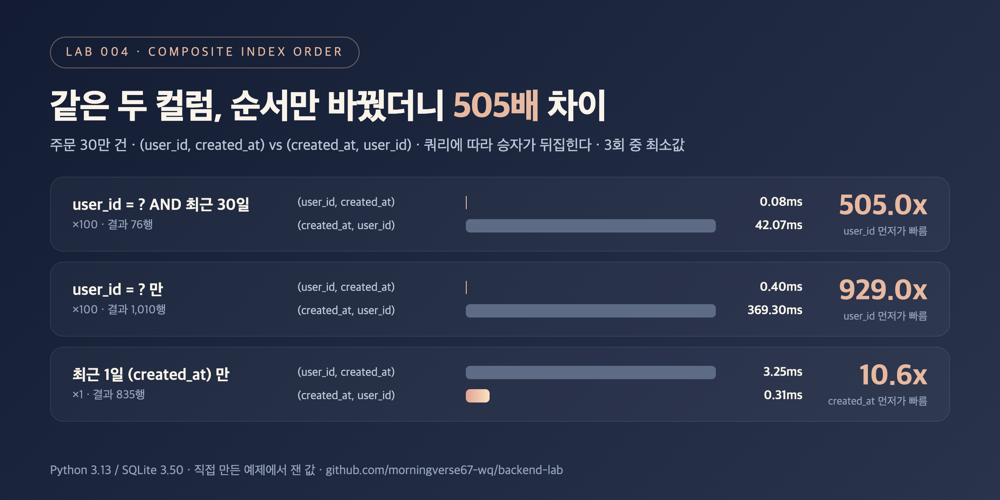

# DB-03. 복합 인덱스의 컬럼 순서는 왜 중요한가요?

## 30초 답변

복합 인덱스는 첫 번째 컬럼으로 정렬하고, 같은 값 안에서 두 번째 컬럼으로 정렬한 구조라서 **왼쪽 컬럼부터 차례로** 조건이 있어야 범위를 좁힐 수 있습니다.
그래서 보통 등호(`=`) 조건 컬럼을 앞에, 범위(`>=`, `BETWEEN`) 조건 컬럼을 뒤에 둡니다.
범위 컬럼이 앞에 오면 그 뒤 컬럼은 범위를 좁히는 데 쓰이지 못하고, 첫 컬럼 조건이 아예 없으면 인덱스를 못 타고 전체를 읽을 수 있습니다.
결국 정답 순서는 **실제로 자주 나가는 쿼리의 조건**이 정합니다.

## 조금 더 깊게

```sql
CREATE INDEX idx ON orders(user_id, created_at);  -- A
CREATE INDEX idx ON orders(created_at, user_id);  -- B

SELECT id, amount FROM orders WHERE user_id = ? AND created_at >= ?;
```

- A는 `user_id = ?`로 한 사용자 구간을 찾은 뒤, 그 안에서 `created_at >= ?` 범위만 읽습니다. 실행 계획: `SEARCH ... (user_id=? AND created_at>?)`.
- B는 `created_at >= ?` 범위의 인덱스 항목을 전부 훑으면서 `user_id`를 하나씩 걸러냅니다. 실행 계획: `SEARCH ... (created_at>?)`. 인덱스를 탔지만 읽는 양이 훨씬 많습니다.
- B에 `user_id`만 주면 첫 컬럼 조건이 없어서 `SCAN`이 됩니다. 반대로 `created_at`만 주는 쿼리는 A에서 `SCAN`, B에서 `SEARCH`가 됩니다.

## 직접 측정한 근거



주문 30만 건, 사용자 3만 명, 1년치 `created_at`. SQLite in-memory. 같은 두 컬럼으로 순서만 바꾼 인덱스를 번갈아 만들어 같은 쿼리를 측정.

| 쿼리 | 반환 행 | 인덱스 없음 (ms) | (user_id, created_at) (ms) | (created_at, user_id) (ms) | 더 빠른 쪽 |
|---|---:|---:|---:|---:|---|
| user_id = ? AND 최근 30일 x100 | 76 | 364.98 | 0.08 | 42.07 | (user_id, created_at) 505.0x |
| user_id = ? x100 | 1,010 | 367.01 | 0.40 | 369.30 | (user_id, created_at) 929.0x |
| 최근 1일 x1 | 835 | 3.31 | 3.25 | 0.31 | (created_at, user_id) 10.6x |

- 순서가 맞지 않는 인덱스는 "인덱스를 탔는데도" 505배 느리거나(범위 컬럼이 앞), 아예 SCAN이 되어 인덱스가 없는 것과 같았습니다(첫 컬럼 조건 없음).
- 날짜만으로 조회하는 쿼리에서는 반대로 `(created_at, user_id)`가 10.6배 빨랐습니다. 어떤 쿼리가 중요한지에 따라 승자가 바뀝니다.
- 재현 코드: [backend-lab/004-composite-index-order](https://github.com/morningverse67-wq/backend-lab/tree/main/labs/004-composite-index-order)

<sub>Python 3.13 / SQLite 3.50, 3회 중 최소값. 환경에 따라 수치는 달라질 수 있음.</sub>

## 꼬리 질문

**Q. 두 쿼리 패턴이 다 중요하면 어떻게 하나요?**  
인덱스를 두 개 두거나, 더 자주 나가고 더 느린 쪽에 맞춥니다. 인덱스가 늘면 INSERT/UPDATE 때 고칠 인덱스도 늘고 저장 공간도 커지므로, 쓰기 비중과 함께 판단합니다.

**Q. 카디널리티가 높은 컬럼을 무조건 앞에 두면 되나요?**  
일반적인 출발점일 뿐입니다. 먼저 조건의 종류(등호인지 범위인지)와 실제 쿼리 패턴을 봐야 합니다. 위 실험에서도 날짜만으로 조회하면 `created_at`이 앞인 인덱스가 이겼습니다.

**Q. 첫 컬럼 조건이 없으면 절대 인덱스를 못 쓰나요?**  
DB에 따라 첫 컬럼 값 종류가 적을 때 skip scan 같은 방식으로 쓰기도 합니다(MySQL 8.0.13+, SQLite 등). 다만 첫 컬럼 값 종류가 많으면 효과가 없어서, 기본적으로는 왼쪽부터 쓴다고 생각하는 게 안전합니다.

## 흔한 오답

- "WHERE 절에 쓰는 순서대로 인덱스를 만들면 됩니다" → 옵티마이저는 WHERE 절의 작성 순서가 아니라 인덱스 컬럼 순서와 조건 종류를 봅니다.
- "두 컬럼이 다 들어 있으니 어느 순서든 비슷합니다" → 위 측정에서 같은 쿼리가 0.08ms와 42.07ms로 505배 차이 났습니다.

## 참고

- [SQLite: Query Planning (Multi-Column Indices)](https://www.sqlite.org/queryplanner.html)
- [SQLite: EXPLAIN QUERY PLAN](https://www.sqlite.org/eqp.html)
- [MySQL 8.0: Multiple-Column Indexes](https://dev.mysql.com/doc/refman/8.0/en/multiple-column-indexes.html)
- [PostgreSQL: Multicolumn Indexes](https://www.postgresql.org/docs/current/indexes-multicolumn.html)
