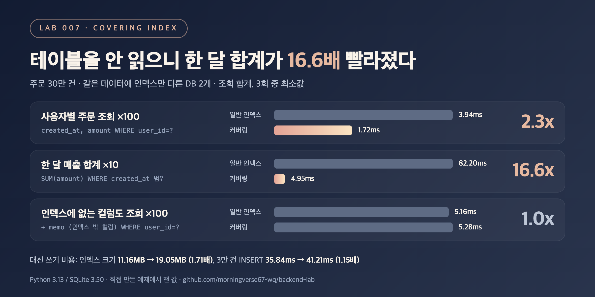

# DB-06. 커버링 인덱스란 무엇인가요?

## 30초 답변

쿼리에 필요한 컬럼(WHERE, SELECT, ORDER BY 등)이 전부 인덱스 안에 있어서, 인덱스만 읽고 테이블은 읽지 않아도 되는 인덱스를 말합니다.
일반 인덱스로 찾으면 "인덱스에서 위치 찾기 → 행마다 테이블 읽기" 두 단계를 거치는데, 커버링 인덱스는 두 번째 단계가 없습니다.
그래서 읽는 행이 많을수록 이득이 커지고, 아래 실험에서는 한 달 매출 합계가 16.6배 빨라졌습니다.
대신 인덱스가 커지고 쓰기가 느려지며, 인덱스에 없는 컬럼을 하나라도 조회하면 효과가 사라집니다.

## 조금 더 깊게

```sql
-- 일반 인덱스: user_id로 찾은 뒤 행마다 테이블에서 created_at, amount를 읽음
CREATE INDEX idx_user ON orders(user_id);

-- 커버링 인덱스: 필요한 컬럼이 인덱스에 다 있음
CREATE INDEX idx_user_cov ON orders(user_id, created_at, amount);

SELECT created_at, amount FROM orders WHERE user_id = ?;
-- SQLite : SEARCH orders USING COVERING INDEX idx_user_cov (user_id=?)
-- MySQL  : EXPLAIN의 Extra 컬럼에 "Using index"
```

- **왜 빠른가**: 일반 인덱스는 찾은 행 수만큼 테이블을 다시 읽습니다. 커버링 인덱스는 이 읽기가 0번이라, 읽는 행이 많을수록 차이가 커집니다.
- **MySQL InnoDB**: 세컨더리 인덱스에는 해당 행의 PK 값이 함께 들어 있습니다. 그래서 PK 컬럼은 인덱스에 따로 넣지 않아도 커버링이 될 수 있고, 커버링이 아니면 PK로 클러스터드 인덱스를 한 번 더 찾습니다.
- **어떻게 확인하나**: SQLite는 `USING COVERING INDEX`, MySQL은 `Extra: Using index`, PostgreSQL은 `Index Only Scan`으로 실행 계획에 나옵니다.
- **비용**: 컬럼을 넣은 만큼 인덱스가 커지고, INSERT/UPDATE 때 고쳐야 할 인덱스 데이터도 늘어납니다.

## 직접 측정한 근거



주문 30만 건(사용자 3,000명, 행마다 200자 `memo`), SQLite in-memory. 같은 행을 넣은 DB 2개에 인덱스만 다르게 두고(일반 `(user_id)`, `(created_at)` / 커버링 `(user_id, created_at, amount)`, `(created_at, amount)`), 같은 쿼리를 돌려 결과가 같은지 확인.

| 쿼리 | 읽은 행 | 일반 인덱스 (ms) | 커버링 인덱스 (ms) | 배율 |
|---|---:|---:|---:|---:|
| 사용자별 `created_at, amount` x100 | 10,055 | 3.94 | 1.72 | 2.3x |
| 한 달 `SUM(amount)` x10 | 249,145 | 82.20 | 4.95 | 16.6x |
| `memo`까지 조회 x100 | 10,055 | 5.16 | 5.28 | 1.0x |

| 쓰기 쪽 비용 | 일반 인덱스 | 커버링 인덱스 | 배율 |
|---|---:|---:|---:|
| 인덱스 2개 크기 | 11.16 MB | 19.05 MB | 1.71x |
| 3만 건 INSERT | 35.84 ms | 41.21 ms | 1.15x |

- 사용자당 100건 남짓을 읽는 조회는 2.3배, 한 번에 약 2.5만 건을 읽는 한 달 합계는 16.6배였습니다. 테이블 읽기가 읽는 행 수만큼 생략되기 때문에 읽는 행이 많을수록 차이가 커졌습니다.
- `memo`를 같이 조회하면 실행 계획에서 `COVERING`이 빠지고(`USING INDEX idx_user_cov`) 1.0배였습니다. 측정은 메모리 DB 기준이라 디스크 I/O는 포함되지 않았습니다.
- 재현 코드: [backend-lab/007-covering-index](https://github.com/morningverse67-wq/backend-lab/tree/main/labs/007-covering-index)

<sub>Python 3.13 / SQLite 3.50, 3회 중 최소값. 환경에 따라 수치는 달라질 수 있음.</sub>

## 꼬리 질문

**Q. 그럼 자주 쓰는 컬럼은 다 인덱스에 넣으면 되나요?**  
아닙니다. 위 측정에서 컬럼 두 개를 더 넣었을 뿐인데 인덱스 크기가 1.71배, 3만 건 INSERT가 1.15배가 됐습니다. 자주 돌고 느린 조회 몇 개에만 맞춰 만들고, 쓰기가 많은 테이블이면 쓰기 비용과 같이 따져야 합니다.

**Q. `SELECT *`를 쓰면 어떻게 되나요?**  
인덱스에 없는 컬럼이 하나라도 있으면 커버링이 안 됩니다. `memo` 하나를 추가하자 1.0배로 일반 인덱스와 같았습니다. 커버링 인덱스를 노린다면 필요한 컬럼만 명시해서 조회해야 합니다.

**Q. 정렬 기준에 쓰지 않는 컬럼도 키에 넣어야 하나요?**  
PostgreSQL 11 이상은 `CREATE INDEX ... INCLUDE (amount)`로 검색 키가 아닌 컬럼을 인덱스에 담을 수 있습니다. MySQL에는 `INCLUDE`가 없어서 이 실험처럼 키 뒤쪽에 컬럼을 붙입니다. 또 PostgreSQL의 Index Only Scan은 최근에 바뀐 행이 많으면 테이블 확인이 다시 생길 수 있습니다.

## 흔한 오답

- "커버링 인덱스는 특별한 종류의 인덱스입니다" → 만드는 문법은 일반 인덱스와 같습니다. 특정 쿼리가 필요로 하는 컬럼을 다 담고 있을 때 그 쿼리 기준으로 "커버링"이라고 부릅니다. 같은 인덱스도 `memo`를 조회하는 쿼리에서는 커버링이 아니었습니다.
- "인덱스를 넓히면 항상 빨라집니다" → 조회하는 컬럼이 인덱스 밖에 있으면 1.0배였고, 쓰기 쪽에서는 인덱스 크기 1.71배, INSERT 1.15배로 비용만 늘었습니다.

## 참고

- [MySQL 8.0: EXPLAIN Extra Information (Using index)](https://dev.mysql.com/doc/refman/8.0/en/explain-output.html#explain-extra-information)
- [MySQL 8.0: Clustered and Secondary Indexes](https://dev.mysql.com/doc/refman/8.0/en/innodb-index-types.html)
- [PostgreSQL: Index-Only Scans and Covering Indexes](https://www.postgresql.org/docs/current/indexes-index-only-scans.html)
- [SQLite: Query Planning (Covering Indexes)](https://www.sqlite.org/queryplanner.html#_covering_indexes)
