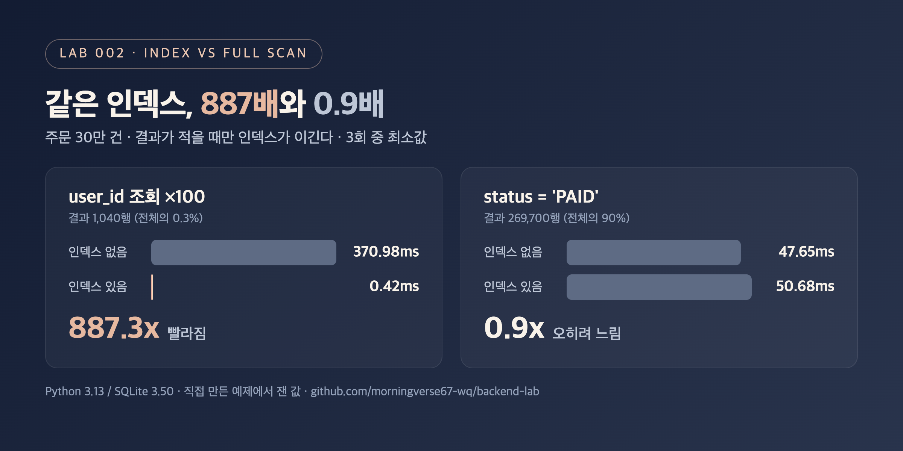

# DB-02. 인덱스는 왜 빠르고, 언제 소용없나요?

## 30초 답변

인덱스는 컬럼 값을 정렬된 구조(B-Tree 계열)로 따로 저장해 두어서, 테이블 전체를 읽지 않고 **원하는 위치를 바로 찾아가게** 해 줍니다.
그래서 **결과가 전체의 아주 일부인 조회**에서 크게 빨라집니다.
반대로 결과가 테이블 대부분이면, 인덱스를 따라간 뒤 행마다 테이블을 다시 찾아가야 해서 이득이 없거나 더 느릴 수 있습니다.

## 조금 더 깊게

```sql
SELECT id, amount FROM orders WHERE user_id = ?;      -- 30만 건 중 평균 10건
SELECT id, amount FROM orders WHERE status = 'PAID';  -- 30만 건 중 90%
```

- 인덱스가 없으면 실행 계획은 `SCAN`(전체 읽기), 있으면 `SEARCH ... USING INDEX`로 바뀝니다.
- 하지만 **인덱스를 탔다는 것과 빨라졌다는 것은 다른 이야기**입니다. 실행 계획과 실제 시간을 같이 봐야 합니다.

## 직접 측정한 근거



주문 30만 건, 사용자 3만 명, 상태 PAID 90% / CANCELLED 10%. SQLite in-memory.

| 케이스 | 반환 행 | 인덱스 없음 (ms) | 인덱스 있음 (ms) | 배율 |
|---|---:|---:|---:|---:|
| user_id 조회 x100 | 1,040 | 370.98 | 0.42 | 887.3x |
| status = 'PAID' x1 | 269,700 | 47.65 | 50.68 | 0.9x |

```text
user_id 조회   before: SCAN orders
               after : SEARCH orders USING INDEX idx_orders_user_id (user_id=?)
status 조회    before: SCAN orders
               after : SEARCH orders USING INDEX idx_orders_status (status=?)
```

- 두 쿼리 모두 인덱스를 탔지만, 하나는 887배 빨라지고 하나는 오히려 조금 느려졌습니다.
- 재현 코드: [backend-lab/002-index-scan](https://github.com/morningverse67-wq/backend-lab/tree/main/labs/002-index-scan)

<sub>Python 3.13 / SQLite 3.50, 3회 중 최소값. 환경에 따라 수치는 달라질 수 있음.</sub>

## 꼬리 질문

**Q. 그럼 인덱스를 많이 만들면 좋은가요?**  
아닙니다. INSERT, UPDATE, DELETE 때마다 인덱스도 같이 고쳐야 해서 쓰기가 느려지고 저장 공간도 늘어납니다. 자주 쓰는 조회 조건 위주로 만듭니다.

**Q. 선택도(cardinality)가 낮은 컬럼은요?**  
상태값처럼 값 종류가 적은 컬럼은 단독 인덱스 효과가 작습니다. 다른 조건 컬럼과 묶은 복합 인덱스로 쓰는 경우가 많습니다.

**Q. 인덱스가 있는데도 안 타는 경우는?**  
컬럼에 함수를 씌우거나(`WHERE DATE(created_at) = ...`), 앞에 와일드카드가 붙은 LIKE(`'%abc'`), 타입이 달라 형변환이 일어나는 경우 등입니다.

## 흔한 오답

- "인덱스를 걸면 무조건 빨라집니다" → 결과 비율이 크면 이득이 없습니다(위 0.9x).
- "EXPLAIN에 인덱스가 나오니 최적화 끝" → 실제 시간과 읽은 행 수를 같이 확인해야 합니다.

## 참고

- [SQLite: EXPLAIN QUERY PLAN](https://www.sqlite.org/eqp.html)
- [SQLite: Query Planning](https://www.sqlite.org/queryplanner.html)
