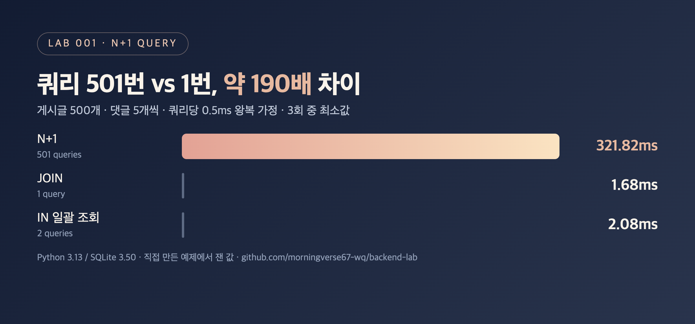

# DB-01. N+1 문제란 무엇이고 어떻게 해결하나요?

## 30초 답변

목록을 1번 조회한 뒤, 항목마다 연관 데이터를 다시 조회해서 쿼리가 **1 + N번** 나가는 문제입니다.
쿼리 하나하나는 빠르지만 **DB까지 오가는 횟수**가 N에 비례해 늘어나서 느려집니다.
조인으로 한 번에 가져오거나, 식별자를 모아 `IN` 절로 한 번에 가져와서 쿼리 수를 N과 무관하게 만들면 해결됩니다.

## 조금 더 깊게

```python
posts = query("SELECT id, title FROM post")                         # 1번
for post in posts:
    post.comments = query("SELECT * FROM comment WHERE post_id = ?", post.id)  # N번
```

- ORM의 지연 로딩(lazy loading), MyBatis의 중첩 select(Nested Select)에서 흔히 생깁니다.
- 로그에서 **식별자만 바뀐 같은 쿼리가 반복**되고, 목록 크기를 늘리면 쿼리 수도 같이 늘어난다면 N+1을 의심합니다.

## 직접 측정한 근거



게시글 500개, 게시글당 댓글 5개. SQLite in-memory, 쿼리마다 0.5ms 왕복을 가정.

| 방식 | 쿼리 수 | in-memory (ms) | 왕복 0.5ms 가정 (ms) |
|---|---:|---:|---:|
| N+1 | 501 | 0.83 | 321.82 |
| JOIN 1번 | 1 | 0.66 | 1.68 |
| IN 일괄 조회 | 2 | 0.63 | 2.08 |

- 같은 프로세스 안의 메모리 DB에서는 차이가 거의 없습니다. **비용의 대부분은 쿼리 실행이 아니라 왕복**입니다.
- 재현 코드: [backend-lab/001-n-plus-one](https://github.com/morningverse67-wq/backend-lab/tree/main/labs/001-n-plus-one)

<sub>Python 3.13 / SQLite 3.50, 3회 중 최소값. 환경에 따라 수치는 달라질 수 있음.</sub>

## 꼬리 질문

**Q. JOIN과 IN 일괄 조회 중 무엇을 고르나요?**  
JOIN은 1번이지만 일대다에서 부모 행이 자식 수만큼 중복되어 전송량이 늘고, 페이징이 어긋날 수 있습니다. 자식이 많거나 목록에 페이징이 있으면 IN 일괄 조회(JPA `batch_size`, MyBatis `collection` + IN)가 다루기 쉽습니다.

**Q. IN 절에 id를 몇 개까지 넣을 수 있나요?**  
DB마다 파라미터 수나 쿼리 길이에 상한이 있습니다. 실제로는 일정 크기(예: 수백~천 개)로 나눠서 보냅니다.

**Q. 쿼리 수가 줄면 항상 빨라지나요?**  
아닙니다. 큰 JOIN 한 번이 작은 쿼리 여러 번보다 느릴 수도 있습니다. 바꾸기 전후를 같은 입력으로 돌려 쿼리 수, 응답 시간, 반환 데이터를 같이 비교해야 합니다.

## 흔한 오답

- "쿼리가 많아서 DB가 힘들어서 느려요" → 핵심은 DB 부하보다 **왕복 횟수**입니다.
- "Fetch Join 쓰면 무조건 해결돼요" → 컬렉션 fetch join은 페이징과 함께 쓰기 어렵고, 행 중복 문제가 생깁니다.

## 참고

- [MyBatis: Nested Select for Association](https://mybatis.org/mybatis-3/sqlmap-xml.html#Nested_Select_for_Association)
- 블로그 글: [MyBatis N+1 문제 해결, 로그 확인부터 일대다 페이징까지](https://velog.io/@morningverse/N1-쿼리는-왜-생길까)
