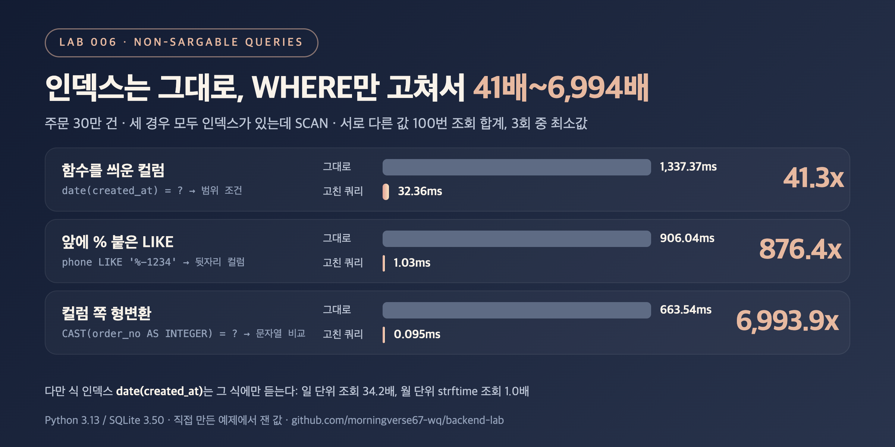

# DB-05. 인덱스를 못 타는 쿼리에는 어떤 것이 있나요?

## 30초 답변

인덱스는 컬럼 값을 **그대로** 정렬해 둔 구조라서, WHERE에서 컬럼 쪽을 가공하면 어디서부터 찾아야 할지 몰라 테이블 전체를 읽게 됩니다.
대표적으로 컬럼에 함수를 씌운 조건(`DATE(created_at) = ?`), 앞에 `%`가 붙은 LIKE(`LIKE '%1234'`), 컬럼 쪽에 형변환이 일어나는 비교가 있습니다.
고치는 방향은 컬럼은 그대로 두고 값 쪽을 바꾸는 것입니다. 예를 들어 날짜 함수는 `created_at >= ? AND created_at < ?` 범위 조건으로, 뒷자리 검색은 뒷자리를 따로 저장한 컬럼으로 바꿉니다.
아래 실험에서는 인덱스를 하나도 바꾸지 않고 WHERE만 고쳐서 41.3배~6,993.9배 빨라졌습니다.

## 조금 더 깊게

```sql
-- 인덱스가 있어도 SCAN
WHERE date(created_at) = '2026-03-15'
WHERE phone LIKE '%-1234'
WHERE CAST(order_no AS INTEGER) = 12345678

-- 같은 결과, 인덱스로 SEARCH
WHERE created_at >= '2026-03-15' AND created_at < '2026-03-16'
WHERE phone_last4 = '1234'          -- 뒷자리를 따로 저장하고 인덱스
WHERE order_no = '12345678'         -- 파라미터 타입을 컬럼 타입에 맞춤
```

- **함수**: 인덱스에는 `created_at` 값이 정렬돼 있지 `date(created_at)` 값이 정렬돼 있지 않습니다. 같은 뜻의 범위 조건으로 바꾸면 인덱스 범위 검색이 됩니다.
- **앞에 붙은 `%`**: 앞부분을 모르면 정렬 순서를 쓸 수 없습니다. `LIKE 'abc%'`처럼 앞이 고정된 패턴은 DB에 따라 범위 검색으로 바뀔 수 있습니다.
- **형변환**: MySQL은 문자열 컬럼을 숫자와 비교하면 컬럼 값을 숫자로 바꿔 비교해서 인덱스로 값을 빠르게 찾지 못한다고 문서에 적혀 있습니다. 변환 규칙은 DB마다 다르니 파라미터 타입을 컬럼 타입에 맞추는 게 안전합니다.
- 함수를 꼭 써야 하면 **식 인덱스**(MySQL 8.0.13+의 함수 기반 키 파트, PostgreSQL의 식 인덱스)를 만들 수 있지만, 그 식과 똑같이 쓴 쿼리에만 쓰입니다.

## 직접 측정한 근거



주문 30만 건, SQLite in-memory. `created_at`, `phone`, `phone_last4`, `order_no`에 인덱스. 서로 다른 값 100개로 조회한 합계, 두 쿼리의 결과가 같은지 확인.

| 케이스 | 반환 행 | 그대로 (ms) | 고친 쿼리 (ms) | 배율 |
|---|---:|---:|---:|---:|
| `date(created_at) = ?` → 범위 조건 | 82,141 | 1,337.37 | 32.36 | 41.3x |
| `phone LIKE '%-1234'` → `phone_last4 = ?` | 3,009 | 906.04 | 1.03 | 876.4x |
| `CAST(order_no AS INTEGER) = ?` → `order_no = '...'` | 100 | 663.54 | 0.095 | 6,993.9x |

| 식 인덱스 `date(created_at)`를 만든 뒤 | 전 (ms) | 후 (ms) | 배율 |
|---|---:|---:|---:|
| `date(created_at) = ?` x100 | 1,340.69 | 39.22 | 34.2x |
| `strftime('%Y-%m', created_at) = ?` x1 | 35.42 | 34.89 | 1.0x (여전히 `SCAN`) |

- 세 경우 모두 "그대로" 쿼리의 실행 계획은 `SCAN orders`, 고친 쿼리는 `SEARCH ... USING INDEX`였습니다. 같은 달을 범위 조건으로 조회하면 8.87ms로 기존 `created_at` 인덱스를 그대로 썼습니다.
- SQLite는 문자열 컬럼에 숫자 파라미터를 넘겨도 상수 쪽을 바꿔서 인덱스를 탔습니다(100회 0.089ms). 그래서 형변환 케이스는 MySQL이 하는 컬럼 쪽 변환을 `CAST`로 직접 써서 재현한 값입니다.
- 재현 코드: [backend-lab/006-non-sargable-queries](https://github.com/morningverse67-wq/backend-lab/tree/main/labs/006-non-sargable-queries)

<sub>Python 3.13 / SQLite 3.50, 3회 중 최소값. 환경에 따라 수치는 달라질 수 있음.</sub>

## 꼬리 질문

**Q. 그럼 LIKE는 쓰면 안 되나요?**  
문제는 LIKE가 아니라 앞에 붙은 `%`입니다. MySQL은 와일드카드로 시작하지 않는 상수 패턴(`LIKE 'abc%'`)을 범위 조건으로 처리할 수 있습니다. SQLite는 대소문자 규칙(collation) 같은 조건이 맞아야 같은 최적화를 합니다. 접두어 LIKE는 이 실험에서 따로 재지 않았습니다.

**Q. 함수를 꼭 써야 하면 어떻게 하나요?**  
식 인덱스를 만들 수 있습니다. 다만 위 측정처럼 `date(created_at)` 식 인덱스는 같은 식의 조회만 34.2배 빨라지고, 월 단위 `strftime` 조회는 1.0배로 그대로였습니다. 조회 패턴이 여러 개면 컬럼을 그대로 두고 범위 조건으로 쓰는 편이 인덱스 하나로 여러 쿼리를 받습니다.

**Q. 인덱스를 못 타는지 어떻게 확인하나요?**  
실행 계획을 봅니다. SQLite는 `EXPLAIN QUERY PLAN`에서 `SCAN`/`SEARCH`, MySQL은 `EXPLAIN`의 `type`(ALL이면 전체 읽기)과 `key` 컬럼으로 확인합니다.

## 흔한 오답

- "WHERE에 인덱스 컬럼이 들어가 있으면 인덱스를 탑니다" → 컬럼을 가공하면 `SCAN`입니다. 위 세 쿼리 모두 인덱스가 있었지만 전체를 읽었습니다.
- "식 인덱스를 만들면 함수 조건은 다 해결됩니다" → 인덱스를 만든 식과 똑같이 쓴 쿼리에만 쓰입니다. 다른 식(`strftime` 월 조회)은 1.0배였습니다.

## 참고

- [MySQL 8.0: Type Conversion in Expression Evaluation](https://dev.mysql.com/doc/refman/8.0/en/type-conversion.html)
- [MySQL 8.0: Range Optimization](https://dev.mysql.com/doc/refman/8.0/en/range-optimization.html)
- [MySQL 8.0: CREATE INDEX (Functional Key Parts)](https://dev.mysql.com/doc/refman/8.0/en/create-index.html#create-index-functional-key-parts)
- [PostgreSQL: Indexes on Expressions](https://www.postgresql.org/docs/current/indexes-expressional.html)
- [SQLite: Indexes On Expressions](https://www.sqlite.org/expridx.html)
- [SQLite: The LIKE Optimization](https://www.sqlite.org/optoverview.html#the_like_optimization)
