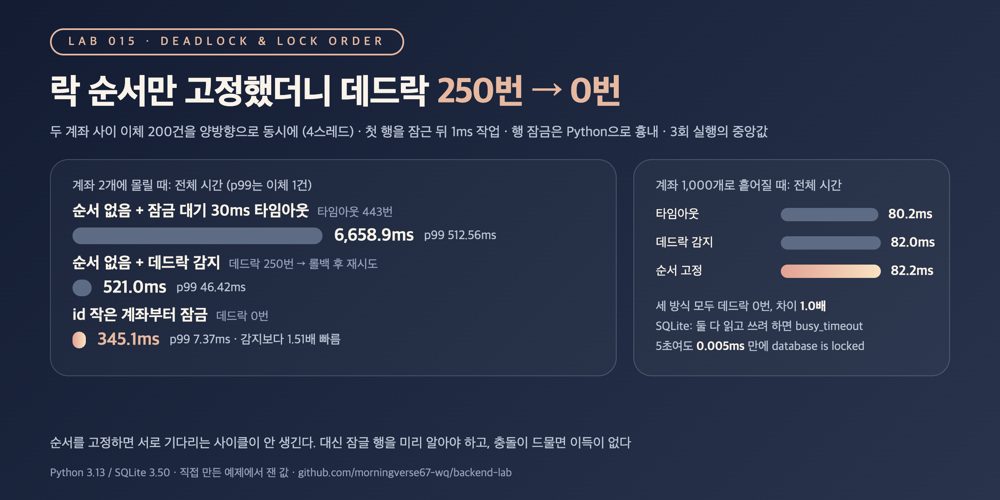

# TX-06. 데드락은 왜 생기고 어떻게 피하나요?

## 30초 답변

데드락은 두 트랜잭션이 각자 행 하나씩을 잠근 채 상대가 쥔 행을 기다릴 때 생깁니다. A→B 이체와 B→A 이체가 동시에 오면 서로 반대 순서로 잠그다가 둘 다 멈춥니다. DB는 한쪽을 롤백해서 끊어 주지만(InnoDB는 기본으로 바로 감지), 롤백된 쪽은 처음부터 다시 해야 합니다. 그래서 여러 행을 잠글 때는 id 순서처럼 **항상 같은 순서로** 잠가 사이클이 생기지 않게 하고, 그래도 나는 데드락은 트랜잭션 전체를 재시도하는 코드로 받습니다.
아래 실험에서 두 계좌 사이 양방향 이체 200건은 순서 없이 잠그면 데드락이 250번 났고, 작은 id부터 잠그자 0번이 됐습니다.

## 조금 더 깊게

```sql
-- 보내는 쪽/받는 쪽과 상관없이 id가 작은 계좌부터 잠근다
-- (앱에서 first = min(from, to), second = max(from, to))
START TRANSACTION;
SELECT balance FROM accounts WHERE id = :first  FOR UPDATE;
SELECT balance FROM accounts WHERE id = :second FOR UPDATE;
UPDATE accounts SET balance = balance - :amount WHERE id = :from;
UPDATE accounts SET balance = balance + :amount WHERE id = :to;
COMMIT;
-- 그래도 데드락 오류(MySQL 1213, PostgreSQL 40P01)가 오면 트랜잭션 전체를 다시 시도
```

- **조건 네 가지가 다 있어야 생깁니다**: 잠금을 혼자 쥐고, 쥔 채로 다른 걸 기다리고, 남이 뺏을 수 없고, 기다림이 원을 이룰 때입니다. 실무에서 끊기 쉬운 건 마지막 하나라서, 잠그는 순서를 하나로 정합니다.
- **DB가 끊는 방법은 두 가지입니다**: InnoDB는 기다림 그래프를 바로 검사해서 바꾼 행이 적은 트랜잭션을 롤백합니다(`innodb_deadlock_detect`, 기본 ON). 감지를 끄면 `innodb_lock_wait_timeout`(기본 50초)이 지나야 롤백됩니다. PostgreSQL은 잠금을 `deadlock_timeout`(기본 1초)만큼 기다린 뒤에 검사합니다.
- **같은 행이라도 약한 잠금에서 강한 잠금으로 올리면 생깁니다**: 둘 다 읽기 잠금을 잡은 뒤 둘 다 쓰려 하면 서로를 기다립니다. 쓸 행이면 처음부터 `FOR UPDATE`(SQLite는 `BEGIN IMMEDIATE`)로 잡습니다.
- **트랜잭션을 짧게 둡니다**: 잠금을 쥔 채 외부 호출이나 긴 계산을 하면 겹치는 시간이 길어져 데드락도, 대기도 늘어납니다.

## 직접 측정한 근거



SQLite 파일 DB(WAL)에 계좌 테이블을 두고 4스레드가 이체 50건씩, 모두 200건을 보냈습니다. SQLite에는 행 잠금이 없어서 행 잠금·데드락 감지·잠금 대기 타임아웃은 Python으로 흉내 냈습니다. 첫 행을 잠그고 1ms 작업한 뒤 두 번째 행을 잠그고, 두 행을 SQLite 트랜잭션 하나로 씁니다. 롤백되면 0~2ms 쉬고 다시 시도합니다. 같은 이체 목록으로 3회 실행해 지표별 중앙값을 적었습니다.

| 계좌 수 | 잠그는 방법 | 데드락 | 타임아웃 | 전체 시간 | 이체 1건 p99 |
|---|---|---:|---:|---:|---:|
| 2 | 순서 없음 + 30ms 타임아웃 | - | 443 | 6,658.9ms | 512.56ms |
| 2 | 순서 없음 + 데드락 감지 | 250 | 0 | 521.0ms | 46.42ms |
| 2 | id 작은 계좌부터 | 0 | 0 | 345.1ms | 7.37ms |
| 1,000 | 순서 없음 + 30ms 타임아웃 | - | 0 | 80.2ms | 2.06ms |
| 1,000 | 순서 없음 + 데드락 감지 | 0 | 0 | 82.0ms | 2.13ms |
| 1,000 | id 작은 계좌부터 | 0 | 0 | 82.2ms | 2.13ms |

- 세 방식 모두 계좌별 최종 잔액은 같았습니다. 데드락은 데이터를 깨뜨리지 않고 재시도와 시간을 씁니다. 계좌 2개에서 순서를 고정하면 감지 방식보다 1.51배 빨랐고 p99는 46.42ms → 7.37ms였습니다. 감지 없이 타임아웃만 기다리면 묶인 이체 뒤로 대기가 줄줄이 타임아웃에 걸려 감지 방식의 12.8배가 걸렸습니다.
- 계좌가 1,000개로 흩어지면 같은 두 행을 반대로 잡을 일이 거의 없어 세 방식 모두 데드락 0번, 시간도 1.0배였습니다. 순서 고정은 충돌이 몰리는 곳에서 효과가 납니다. 참고로 SQLite에서 두 읽기 트랜잭션이 둘 다 쓰려 하자 `busy_timeout` 5초를 기다리지 않고 0.005ms 만에 `database is locked`가 났고, `BEGIN IMMEDIATE`로 쓰기 잠금을 먼저 잡으면 실패 없이 기다렸습니다.
- 재현 코드: [backend-lab/015-deadlock-lock-order](https://github.com/morningverse67-wq/backend-lab/tree/main/labs/015-deadlock-lock-order)

<sub>Python 3.13 / SQLite 3.50, 파일 DB(WAL, synchronous=NORMAL). 행 잠금과 데드락 감지는 InnoDB나 PostgreSQL이 아니라 Python으로 흉내 낸 것이고, 롤백할 쪽은 기다리려던 트랜잭션으로 정했습니다. 타임아웃 방식은 데드락과 단순히 긴 대기를 구분하지 못해 데드락 칸을 "-"로 두었습니다. 실행 시간을 줄이려고 타임아웃을 30ms로 짧게 잡았습니다. 환경에 따라 수치는 달라질 수 있음.</sub>

## 꼬리 질문

**Q. 데드락이 나면 애플리케이션은 무엇을 해야 하나요?**  
롤백된 쪽은 오류(MySQL 1213, PostgreSQL 40P01)를 받으니 트랜잭션 전체를 처음부터 다시 실행합니다. 마지막 문장만 다시 보내면 안 됩니다. 앞에서 바꾼 내용도 같이 롤백됐기 때문입니다. MySQL 문서도 데드락으로 실패한 트랜잭션은 언제든 다시 실행할 준비를 하라고 합니다. 실험에서는 0~2ms 랜덤하게 쉬고 다시 시도했고, 다시 시도한 이체가 또 걸리기도 해서 데드락 수(250번)가 이체 수(200건)보다 많았습니다.

**Q. 잠글 행을 미리 알 수 없으면 순서를 어떻게 정하나요?**  
첫 행을 읽어야 다음 행이 정해지는 흐름이면 순서를 고정할 수 없습니다. 이럴 때는 필요한 행을 먼저 조회해 목록을 만든 뒤 정렬해서 잠그거나, 부모 행처럼 공통으로 잡는 행 하나를 먼저 잠가 줄을 세웁니다. 줄을 세우면 데드락은 없어지지만 동시에 처리할 수 있는 양이 줄어듭니다. 어느 쪽도 어렵다면 데드락 재시도 코드를 두고 트랜잭션을 짧게 유지합니다.

**Q. 데드락 감지를 끄고 타임아웃만 쓰면 안 되나요?**  
MySQL 문서는 같은 잠금을 기다리는 스레드가 아주 많으면 감지 자체가 느려질 수 있어서 끄고 `innodb_lock_wait_timeout`에 맡기는 편이 나을 때가 있다고 합니다. 다만 그 동안 묶인 트랜잭션이 타임아웃까지 버티므로, 실험처럼 충돌이 몰리는 곳에서는 감지 방식의 12.8배가 걸렸습니다. 끄려면 타임아웃을 짧게 잡고 데드락 자체를 순서 고정으로 줄여 두는 게 먼저입니다.

## 흔한 오답

- "잠금 대기 타임아웃을 늘리면 데드락이 해결됩니다" → 데드락은 기다린다고 풀리지 않습니다. 타임아웃은 끊기까지 걸리는 시간일 뿐이라 늘릴수록 묶인 트랜잭션과 그 뒤의 요청이 더 오래 멈춥니다.
- "DB가 데드락을 알아서 처리하니 애플리케이션은 신경 쓸 필요가 없습니다" → DB는 한쪽을 롤백할 뿐이고, 그 요청은 오류로 끝납니다. 재시도 코드가 없으면 사용자가 실패를 받습니다. 실험에서도 데드락 250번은 모두 재시도로 메웠습니다.

## 참고

- [MySQL 8.4: Deadlock Detection](https://dev.mysql.com/doc/refman/8.4/en/innodb-deadlock-detection.html)
- [MySQL 8.4: How to Minimize and Handle Deadlocks](https://dev.mysql.com/doc/refman/8.4/en/innodb-deadlocks-handling.html)
- [PostgreSQL: Explicit Locking (Deadlocks)](https://www.postgresql.org/docs/current/explicit-locking.html#LOCKING-DEADLOCKS)
- [PostgreSQL: deadlock_timeout](https://www.postgresql.org/docs/current/runtime-config-locks.html#GUC-DEADLOCK-TIMEOUT)
- [SQLite: sqlite3_busy_handler](https://www.sqlite.org/c3ref/busy_handler.html)
- [SQLite: BEGIN TRANSACTION](https://www.sqlite.org/lang_transaction.html)
