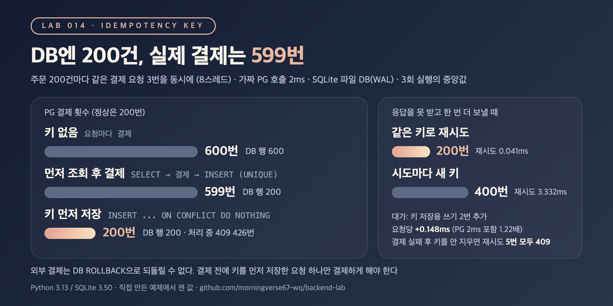

# TX-05. 중복 결제 요청은 어떻게 막나요? (멱등성 키)

## 30초 답변

클라이언트가 결제 하나마다 고유한 멱등성 키(보통 UUID)를 만들어 요청에 넣고, 재시도할 때도 같은 키를 보냅니다. 서버는 결제를 부르기 **전에** 키를 UNIQUE 테이블에 먼저 저장하고, 저장에 성공한 요청 하나만 결제한 뒤 응답을 키와 함께 남깁니다. 같은 키가 다시 오면 결제하지 않고 저장된 응답을 돌려주고, 아직 처리 중이면 409로 잠시 뒤 다시 보내게 합니다.
아래 실험에서 같은 결제 요청을 3번씩 보낸 주문 200건은, 키를 먼저 조회하고 결제하는 코드에서 DB 행은 200건인데 PG 결제가 599번 나갔고, 키를 먼저 저장하자 200번이었습니다.

## 조금 더 깊게

```sql
-- 1) 결제 전에 키부터 선점 (넣은 요청만 다음 단계로)
INSERT INTO idempotency_keys (key, request_hash, status)
VALUES (?, ?, 'processing')
ON CONFLICT (key) DO NOTHING
RETURNING key;            -- 행이 돌아오면 내가 주인, 없으면 이미 누가 처리 중이거나 끝냄

-- 2) 주인만 PG 결제 호출 후, 결과를 키에 기록
UPDATE idempotency_keys SET status = 'done', payment_id = ? WHERE key = ?;

-- 3) 주인이 아니면 저장된 상태를 보고 응답
SELECT request_hash, status, payment_id FROM idempotency_keys WHERE key = ?;
-- 해시가 다르면 422, processing이면 409, done이면 저장된 응답을 그대로
```

- **"먼저 조회 후 처리"는 안 됩니다**: `SELECT`로 키가 없음을 확인하는 사이에 같은 키 요청이 또 들어오면 둘 다 결제까지 갑니다. UNIQUE 제약이 있어도 막히는 건 결제 뒤의 INSERT라서, DB는 깨끗한데 돈은 두 번 나갑니다.
- **판정은 DB의 UNIQUE에 맡깁니다**: "넣기에 성공한 요청이 주인"으로 정하면 앱에서 락을 따로 잡지 않아도 동시에 온 요청 중 하나만 통과합니다.
- **요청 내용 해시를 같이 저장합니다**: 같은 키로 금액이 다른 요청이 오면 저장된 응답을 주지 않고 거절합니다. 키를 실수로 재사용한 요청을 걸러 냅니다.
- **실패와 정리 규칙이 필요합니다**: 결제가 확실히 실패했으면 키를 지우거나 실패로 기록해 재시도를 받고, 처리 중에 서버가 죽어 `processing`으로 남은 키는 만료 시간이나 결제 조회로 정리합니다. 키는 보관 기간이 지나면 지웁니다.

## 직접 측정한 근거



SQLite 파일 DB(WAL)에 결제 테이블과 키 테이블을 두고, 결제 한 번에 2ms 걸리는 가짜 PG를 붙였습니다. PG 결제 내역은 DB와 따로 기록해서 DB를 롤백해도 남습니다. 주문 200건마다 같은 요청 3번을 8스레드로 거의 동시에 보내고, 3회 실행의 중앙값을 적었습니다.

| 방식 | PG 결제 횟수 | 두 번 이상 결제된 주문 | DB 결제 행 | 전체 시간 |
|---|---:|---:|---:|---:|
| 키 없음 | 600 | 200 | 600 | 545.9ms |
| 키를 먼저 조회 후 결제 (키 UNIQUE) | 599 | 200 | 200 | 467.9ms |
| 결제 전에 키 먼저 저장 | 200 | 0 | 200 | 958.1ms (409 응답 426번) |

| 응답을 못 받고 한 번 더 보낼 때 (주문 200건) | PG 결제 횟수 | 재시도 응답 p50 |
|---|---:|---:|
| 같은 키로 재시도 | 200 | 0.041ms (저장된 응답) |
| 시도마다 새 키 | 400 | 3.332ms (새 결제) |

- 먼저 조회하는 방식은 결제 행도 200건, 같은 주문의 응답도 모두 같아서 DB만 보면 문제가 없어 보였습니다. 문제는 PG 쪽에만 남았습니다(599번).
- 키 먼저 저장 방식의 대가: 같은 키 요청이 409를 받고 기다리느라 전체 시간이 늘었고, 중복 없는 요청 1건도 키 쓰기 2번 때문에 0.043ms → 0.191ms가 됐습니다. PG 호출 2ms를 넣으면 3.083ms → 3.764ms(1.22배)였습니다. 그 밖에 같은 키 + 다른 금액은 422로 거절됐고, PG 실패 뒤 키를 `processing`으로 남기자 같은 키 재시도 5번이 모두 409였습니다(키를 지우면 바로 결제 성공).
- 재현 코드: [backend-lab/014-idempotency-key](https://github.com/morningverse67-wq/backend-lab/tree/main/labs/014-idempotency-key)

<sub>Python 3.13 / SQLite 3.50, 파일 DB(WAL, synchronous=NORMAL). 가짜 PG와 한 프로세스 안의 스레드로 만든 예제이고, 실제 PG나 여러 서버 환경에서는 재지 않았습니다. 키 먼저 저장 방식의 전체 시간은 실행마다 887.8~1,093.5ms로 흔들렸습니다. 환경에 따라 수치는 달라질 수 있음.</sub>

## 꼬리 질문

**Q. 같은 키 요청이 첫 요청 처리 중에 오면 어떻게 하나요?**  
결제를 한 번 더 부르면 안 되니 기다리게 하거나 409로 "처리 중"을 알리고 클라이언트가 잠시 뒤 다시 묻게 합니다. 토스페이먼츠도 첫 요청이 처리 중일 때 같은 요청을 보내면 `409 IDEMPOTENT_REQUEST_PROCESSING`을 돌려주고 다시 요청해 응답을 확인하라고 안내합니다. 실험에서는 409 뒤 3ms 기다렸다가 같은 키로 다시 보내서, 결제 200번에 모든 요청이 같은 결제 ID를 받았습니다.

**Q. 결제가 실패하면 키를 지우나요?**  
실패가 확실할 때만 지우거나 실패로 기록합니다. 실험에서 키를 `processing`으로 남겨 두니 재시도 5번이 모두 409로 막혔습니다. 반대로 타임아웃처럼 PG가 실제로 결제했는지 모르는 경우에 키를 지우거나 새 키로 다시 보내면 두 번 결제될 수 있습니다. 토스페이먼츠 문서도 에러가 났을 때 키를 바꿔 같은 요청을 재시도하는 것은 위험하니 원인을 확인한 뒤 다시 보내라고 합니다.

**Q. 키는 얼마나 보관하나요?**  
재시도가 올 수 있는 기간만큼 두고 지웁니다. 서비스마다 다른데, Stripe는 24시간이 지난 키는 지울 수 있고 지운 뒤 같은 키가 오면 새 요청으로 처리한다고 하고, 토스페이먼츠는 처음 요청한 날부터 15일간 유효하다고 안내합니다. 키 테이블은 요청마다 행이 쌓이므로 만료 시각 컬럼과 정리 작업을 함께 둡니다.

## 흔한 오답

- "결제 테이블에 UNIQUE 제약을 걸면 중복 결제는 막힙니다" → UNIQUE는 DB 행만 막습니다. 결제가 DB 밖에서 먼저 일어나면, 실험처럼 행은 200건인데 결제는 599번 나갈 수 있습니다. 결제 전에 키를 선점하는 데 UNIQUE를 써야 합니다.
- "재시도할 때 서버가 키를 새로 만들어 주면 됩니다" → 시도마다 키가 바뀌면 서버는 같은 결제인지 알 수 없어서 실험에서는 200건 모두 두 번 결제됐습니다. 키는 결제 의도 하나당 클라이언트가 한 번 만들고, 재시도에는 같은 키를 씁니다.

## 참고

- [토스페이먼츠: 멱등키 헤더](https://docs.tosspayments.com/reference/using-api/idempotency-key)
- [Stripe API: Idempotent requests](https://docs.stripe.com/api/idempotent_requests)
- [IETF draft: The Idempotency-Key HTTP Header Field](https://datatracker.ietf.org/doc/draft-ietf-httpapi-idempotency-key-header/)
- [RFC 9110: Idempotent Methods](https://www.rfc-editor.org/rfc/rfc9110.html#name-idempotent-methods)
- [SQLite: UPSERT](https://www.sqlite.org/lang_upsert.html)
- [SQLite: RETURNING](https://www.sqlite.org/lang_returning.html)
- [PostgreSQL: INSERT (ON CONFLICT)](https://www.postgresql.org/docs/current/sql-insert.html)
- Velog: [이벤트 중복 처리, SQLite DO NOTHING 뒤 집계가 늘어나는 함정](https://velog.io/@morningverse/sqlite-event-dedup-returning-count)
