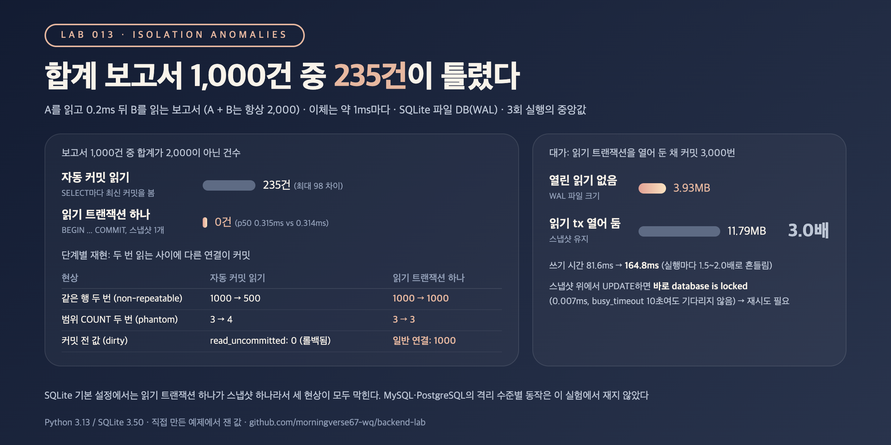

# TX-04. 트랜잭션 격리 수준별로 어떤 현상이 생기나요?

## 30초 답변

격리 수준은 다른 트랜잭션이 바꾼 데이터를 언제부터 보이게 할지 정하는 설정입니다. READ UNCOMMITTED는 커밋 안 된 값을 읽는 dirty read, READ COMMITTED는 같은 데이터를 다시 읽을 때 값이 바뀌는 non-repeatable read와 행이 늘거나 주는 phantom read, 표준의 REPEATABLE READ는 phantom read까지 생길 수 있고, SERIALIZABLE은 셋 다 막습니다. MySQL InnoDB의 기본값은 REPEATABLE READ, PostgreSQL은 READ COMMITTED입니다.
아래 실험에서 A를 읽고 0.2ms 뒤 B를 읽는 합계 보고서는 문장마다 최신 커밋을 보게 하자 1,000건 중 235건이 틀렸고, 읽기 트랜잭션 하나(스냅샷 하나)로 묶자 0건이었습니다. 대신 스냅샷을 오래 열어 두면 그동안의 변경 이력을 지우지 못하는 비용이 있습니다.

## 조금 더 깊게

```sql
-- READ COMMITTED처럼 문장마다 새 스냅샷: 두 SELECT 사이 이체가 커밋되면 합계가 틀림
SELECT balance FROM accounts WHERE id = 1;
SELECT balance FROM accounts WHERE id = 2;

-- 트랜잭션 하나에 스냅샷 하나 (MySQL REPEATABLE READ의 일반 SELECT, PostgreSQL REPEATABLE READ)
START TRANSACTION;
SELECT balance FROM accounts WHERE id = 1;
SELECT balance FROM accounts WHERE id = 2;   -- 첫 SELECT 때의 스냅샷 기준
COMMIT;
```

| 격리 수준 (SQL 표준) | dirty read | non-repeatable read | phantom read |
|---|:---:|:---:|:---:|
| READ UNCOMMITTED | 생길 수 있음 | 생길 수 있음 | 생길 수 있음 |
| READ COMMITTED | 없음 | 생길 수 있음 | 생길 수 있음 |
| REPEATABLE READ | 없음 | 없음 | 생길 수 있음 |
| SERIALIZABLE | 없음 | 없음 | 없음 |

- **표는 "최소한 이것은 막는다"는 뜻입니다**: PostgreSQL의 REPEATABLE READ는 phantom read도 막고, READ UNCOMMITTED는 READ COMMITTED처럼 동작합니다. DB마다 실제 동작이 표보다 강할 수 있습니다.
- **MySQL InnoDB REPEATABLE READ**: 일반 `SELECT`는 트랜잭션의 첫 읽기 때 만든 스냅샷을 계속 읽습니다. 반면 `SELECT ... FOR UPDATE`, `UPDATE` 같은 잠금 문장은 가장 최근에 커밋된 값을 읽고, 범위에는 next-key lock을 걸어 그 사이 `INSERT`를 막습니다.
- **스냅샷은 읽기만 지켜 줍니다**: 스냅샷에서 읽은 옛 값으로 계산해 쓰면 lost update가 생길 수 있습니다. 쓰기 충돌은 락, 조건부 `UPDATE`, 또는 DB가 내는 직렬화 에러 후 재시도로 다룹니다.
- **증상은 에러가 아니라 틀린 숫자입니다**: 합계, 정산, 통계처럼 여러 값을 같은 시점 기준으로 맞춰 봐야 하는 조회에서 드러납니다.

## 직접 측정한 근거



SQLite 파일 DB(WAL)에서 연결 두 개로 재현했습니다. SQLite는 격리 수준을 고르는 옵션이 없어서, 문장마다 최신 커밋을 보는 자동 커밋 읽기(READ COMMITTED와 비슷한 모습)와 `BEGIN` ... `COMMIT` 안에서 스냅샷 하나로 읽는 방식을 비교했습니다. dirty read는 SQLite에서 커밋 안 된 값을 볼 수 있는 유일한 방법인 공유 캐시 + `PRAGMA read_uncommitted = 1`로 만들었습니다.

| 측정 | 자동 커밋 읽기 | 읽기 트랜잭션 하나 |
|---|---:|---:|
| 같은 행 두 번 읽기, 사이에 `UPDATE` 커밋 (non-repeatable read) | 1000 → 500 | 1000 → 1000 |
| `COUNT(*)` 두 번, 사이에 조건에 맞는 `INSERT` 커밋 (phantom read) | 3 → 4 | 3 → 3 |
| 합계 보고서 1,000건 중 틀린 합계 (A + B = 2,000, 이체는 약 1ms마다) | 235 | 0 |
| 보고서 1건 p50 | 0.315ms | 0.314ms |

- dirty read: 다른 연결이 잔액을 0으로 바꾸고 커밋하지 않은 상태에서, `read_uncommitted = 1` 연결은 0을 읽었습니다. 그 값은 `ROLLBACK`되어 한 번도 커밋되지 않았습니다. 일반 연결은 1000을 읽었습니다.
- 대가: 읽기 트랜잭션 하나를 열어 둔 채 다른 연결이 커밋 3,000번을 하자 WAL 파일이 3.93MB에서 11.79MB로 3.0배 커졌습니다. 스냅샷 위에서 `UPDATE`하면 기다리지 않고 0.007ms 만에 `database is locked` 에러가 나서 재시도가 필요했습니다.
- 재현 코드: [backend-lab/013-isolation-anomalies](https://github.com/morningverse67-wq/backend-lab/tree/main/labs/013-isolation-anomalies)

<sub>Python 3.13 / SQLite 3.50, 파일 DB(WAL, synchronous=NORMAL). 합계 보고서는 읽기 스레드 4개 x 250건, WAL 크기는 3회 실행의 중앙값. MySQL·PostgreSQL의 격리 수준별 동작은 직접 재지 않았고 공식 문서를 기준으로 적었습니다. 환경에 따라 수치는 달라질 수 있음.</sub>

## 꼬리 질문

**Q. MySQL REPEATABLE READ에서는 phantom read가 생기나요?**  
일반 `SELECT`는 트랜잭션의 스냅샷을 읽어서 다른 트랜잭션이 넣은 행이 보이지 않습니다. `SELECT ... FOR UPDATE` 같은 잠금 읽기는 next-key lock으로 범위 사이의 `INSERT`를 막습니다. 다만 잠금 읽기는 스냅샷이 아니라 최신 커밋을 읽기 때문에, 같은 트랜잭션에서 일반 `SELECT`와 잠금 읽기를 섞으면 서로 다른 결과를 볼 수 있습니다.

**Q. 격리 수준을 올리면 lost update도 막히나요?**  
그것만으로는 아닙니다. 스냅샷은 읽기를 일정하게 할 뿐, 옛 값으로 계산해 덮어쓰는 것까지 막지는 않습니다. DB마다 대응이 다른데, 실험의 SQLite는 스냅샷 위 쓰기를 바로 에러로 막았고 PostgreSQL REPEATABLE READ는 `could not serialize access` 에러를 냅니다. 둘 다 앱이 재시도해야 합니다. 그래서 보통 원자적 `UPDATE`, 낙관적 락, `FOR UPDATE`를 함께 씁니다([TX-01](optimistic-lock.md), [TX-02](optimistic-vs-pessimistic-lock.md)).

**Q. 트랜잭션을 길게 열어 두면 왜 안 좋나요?**  
DB가 그 스냅샷이 볼 수 있는 옛 버전을 지우지 못합니다. 실험에서는 WAL 파일이 3.0배 커졌습니다. MySQL InnoDB 문서도 읽기만 하는 트랜잭션이라도 자주 커밋하지 않으면 undo log를 지우지 못해 커질 수 있다고 설명합니다(MySQL에서는 직접 재지 않았습니다).

## 흔한 오답

- "MySQL 기본 격리 수준은 READ COMMITTED입니다" → InnoDB의 기본값은 REPEATABLE READ이고, READ COMMITTED가 기본인 것은 PostgreSQL입니다.
- "격리 수준을 SERIALIZABLE로 올리면 동시성 문제는 끝입니다" → 충돌하는 트랜잭션이 기다리거나 실패하게 될 뿐이고, 실패한 트랜잭션의 재시도는 앱이 처리해야 합니다. 대기와 재시도가 늘어 처리량도 떨어질 수 있습니다.

## 참고

- [MySQL 8.4: Transaction Isolation Levels](https://dev.mysql.com/doc/refman/8.4/en/innodb-transaction-isolation-levels.html)
- [MySQL 8.4: Consistent Nonlocking Reads](https://dev.mysql.com/doc/refman/8.4/en/innodb-consistent-read.html)
- [MySQL 8.4: Phantom Rows](https://dev.mysql.com/doc/refman/8.4/en/innodb-next-key-locking.html)
- [MySQL 8.4: InnoDB Multi-Versioning](https://dev.mysql.com/doc/refman/8.4/en/innodb-multi-versioning.html)
- [PostgreSQL: Transaction Isolation](https://www.postgresql.org/docs/current/transaction-iso.html)
- [SQLite: Isolation In SQLite](https://www.sqlite.org/isolation.html)
- [SQLite: Write-Ahead Logging](https://www.sqlite.org/wal.html)
